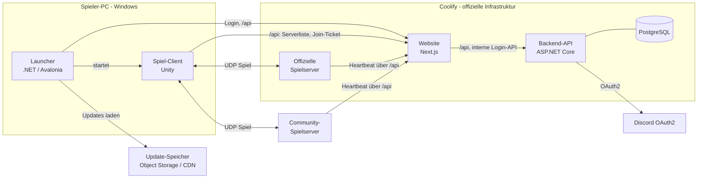
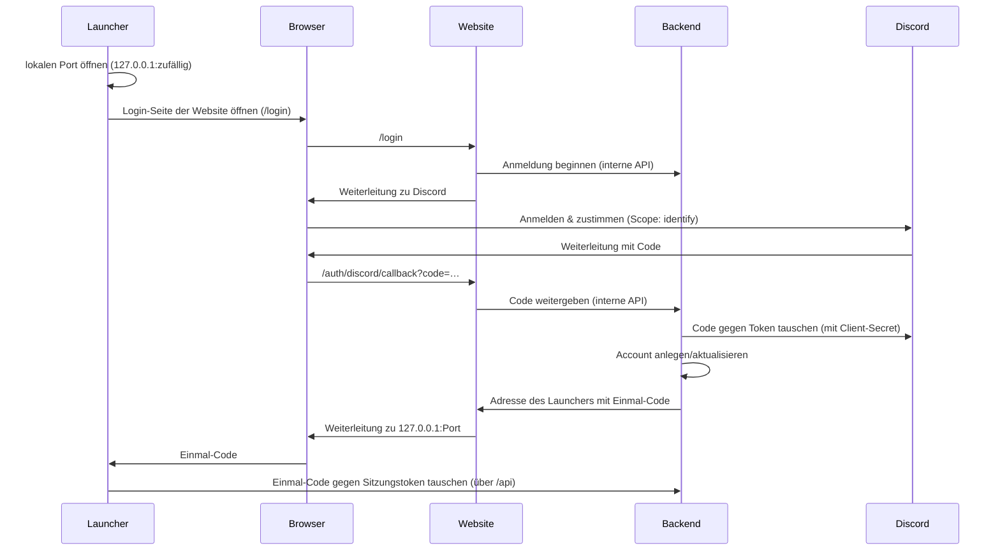

# Ace of Spades 2 – Architektur

> Status: Entwurf. Entscheidungen, die noch offen sind, stehen als **Offen** markiert.

## 1. Überblick



Website und Backend teilen sich eine Adresse: Die Website zeigt die Seiten und reicht alles unter `/api` an das Backend durch. Launcher, Spiel und Spielserver brauchen deshalb nur diese eine Adresse.

| Komponente | Technik | Aufgabe |
|---|---|---|
| **Launcher** | .NET 10, Avalonia, Velopack | Discord-Login, Spiel installieren/aktualisieren, Spiel starten |
| **Client** | Unity 6, URP | Darstellung, Eingabe, Sound, UI, Server-Browser, Vorhersage der eigenen Bewegung |
| **Spielserver** | .NET 10 Konsolenanwendung | Autoritative Spiellogik: Bewegung, Treffer, Blöcke, Punkte |
| **Website** | Next.js 16 (TypeScript) | Startseite, Seiten der Discord-Anmeldung, reicht `/api` an das Backend durch |
| **Backend-API** | ASP.NET Core (.NET 10) + PostgreSQL | Accounts, Discord-Tausch, Sitzungen, Server-Browser (Master-Server), Join-Tickets |
| **Shared-Library** | .NET Standard 2.1, C# 9 | Code, den Client **und** Server gemeinsam nutzen |
| **Update-Speicher** | S3-kompatibler Object Storage | Spieldateien und Update-Manifest |

## 2. Monorepo-Struktur

```
aceofspades2/
├─ client/                     Unity-Projekt
├─ server/
│  ├─ AoS2.Server/             Dedizierter Spielserver
│  └─ AoS2.Server.Tests/
├─ backend/
│  ├─ AoS2.Backend/            Web-API: Login, Accounts, Server-Browser
│  └─ AoS2.Backend.Tests/
├─ launcher/
│  ├─ AoS2.Launcher/           Avalonia-Fenster, Velopack-Self-Update
│  └─ AoS2.Launcher.Tests/
├─ libs/
│  ├─ AoS2.Shared/             Protokoll, Voxel-Welt, Bewegung, Spielregeln
│  ├─ AoS2.Shared.Tests/
│  ├─ AoS2.Updates/            Update-Manifest, Dateivergleich, Download (Launcher + ManifestBuilder)
│  ├─ AoS2.Updates.Tests/
│  ├─ AoS2.Contracts/          Datenformate der Backend-API (DTOs), auch als Unity-Package
│  ├─ AoS2.JoinTickets/        Join-Tickets ausstellen (Backend) und prüfen (Spielserver)
│  └─ AoS2.JoinTickets.Tests/
├─ tools/
│  ├─ AoS2.MapConverter/       MagicaVoxel (.vox) → .aos2map
│  ├─ AoS2.ManifestBuilder/    Erzeugt das Update-Manifest
│  ├─ AoS2.ManifestBuilder.Tests/
│  └─ release/                 Release-Skripte: Unity-Build, Upload, Velopack
├─ data/                       blocks.json, classes.json, weapons.json
├─ maps/                       Map-Quellen und gebaute Maps
├─ assets-src/                 Quelldateien der Assets (siehe docs/assets.md)
├─ deploy/                     Docker-/Compose-Dateien für Coolify
├─ web/                        Website (Next.js): Startseite, Discord-Login, Durchreichen von /api
├─ docs/
├─ .github/workflows/
├─ Directory.Build.props
├─ global.json                 Festgelegte .NET-SDK-Version
└─ AoS2.slnx
```

### Shared-Library in Unity einbinden

- `libs/AoS2.Shared` ist gleichzeitig ein normales .NET-Projekt (`.csproj`) **und** ein Unity-Package (`package.json` + `.asmdef`).
- Unity bindet sie über `client/Packages/manifest.json` ein: `"com.aos2.shared": "file:../../libs/AoS2.Shared"`.
- Damit Unity nicht über `bin/`- und `obj/`-Ordner stolpert, landen alle .NET-Build-Ausgaben zentral in `artifacts/` (`UseArtifactsOutput` in `Directory.Build.props`).
- Regeln für Shared-Code: **keine** Unity-Referenzen, maximal C# 9, nur .NET Standard 2.1-APIs (Grenze, solange Unity auf Mono läuft).

### Spieldaten (`data/`)

Block-, Klassen- und Waffen-Definitionen liegen als JSON in `data/`. Der Server liest sie direkt, der Client bekommt sie beim Build nach `StreamingAssets` kopiert. Der Server ist maßgeblich – der Client nutzt die Daten nur für Anzeige und Vorhersage.

## 3. Netzwerk

### Grundprinzip: Der Server hat immer recht

Der Client schickt nur **Eingaben** und **Absichten** („ich drücke W“, „ich will Block X abbauen“, „ich schieße in Richtung Y“). Der Server prüft alles, berechnet das Ergebnis und schickt den Zustand zurück. So kann ein manipulierter Client nicht einfach behaupten, er habe jemanden getroffen.

### Technik

- **Transport:** LiteNetLib (UDP), Standard-Port `32887`.
- **Simulation:** 60 Ticks/Sekunde auf dem Server.
- **Snapshots:** ca. 30/Sekunde an die Clients.

| Nachrichtentyp | Kanal | Beispiel |
|---|---|---|
| Eingaben | unzuverlässig, jeweils mit den letzten Eingaben als Puffer | Bewegung, Blickrichtung, Feuern |
| Snapshots | unzuverlässig | Positionen aller Spieler |
| Weltänderungen | zuverlässig, geordnet | Block entfernt/gesetzt, Blockgruppe fällt |
| Spielereignisse | zuverlässig | Kill, Punktestand, Spieler beigetreten |

Serialisierung: eigene, schlanke Binär-Serializer in `AoS2.Shared` (keine Reflection, gut testbar).

### Begriffe (für den Einstieg)

- **Client-Vorhersage (Prediction):** Der Client bewegt den eigenen Spieler sofort, ohne auf den Server zu warten. Dafür nutzt er denselben Bewegungscode wie der Server (`AoS2.Shared`).
- **Abgleich (Reconciliation):** Weicht die Server-Position von der vorhergesagten ab, korrigiert der Client sich und spielt die noch nicht bestätigten Eingaben erneut ab.
- **Interpolation:** Andere Spieler werden leicht verzögert und flüssig zwischen zwei Snapshots dargestellt.
- **Lag-Ausgleich (Lag Compensation):** Bei einem Schuss spult der Server die Positionen der anderen Spieler auf den Zeitpunkt zurück, den der Schütze gesehen hat, und prüft dort den Treffer.

### Trefferzonen (Hitboxen)

Ziel: Die Trefferzonen passen **immer exakt** zum sichtbaren Modell und seiner aktuellen Animation.

- **Eine Datenquelle:** `assets-src/tools/export-rig.mjs` liest das Blockbench-Modell und schreibt `data/player_rig.json`. Darin stehen die Knochen (Drehpunkte, Hierarchie), **jeder Würfel als Trefferbox** an seinem Knochen (mit Zone Kopf/Rumpf/Arm/Bein und Klasse bei Ausrüstung) und alle Animationen, mit Blockbenchs eigener Interpolation in 60 Bildern/Sekunde abgetastet. Das Skript wurde gegen Blockbench nachgemessen (gleiche Werte auf 0,001 px).
- **Ein Pose-Rechner für beide Seiten:** `AoS2.Shared` berechnet aus Animationszustand und Zeit die Pose. Der **Client** setzt damit die Knochen des sichtbaren Modells (kein Unity-Animator für den Spielerkörper, sonst könnten Bild und Trefferzonen abweichen). Der **Server** setzt damit die Trefferboxen. Beide rechnen also mit denselben Zahlen.
- **Animationszustand ist Spielzustand:** Welche Animation läuft, seit wann und wie sie überblendet wird, folgt fest aus Werten, die der Server ohnehin kennt (Haltung, Geschwindigkeit, am Boden/in der Luft, Zeitpunkt des Wechsels, Blickwinkel). Keine Zufallswerte, keine nur im Client bekannten Effekte an Knochen mit Trefferboxen.
- **Lag-Ausgleich spult auch die Pose zurück:** Der Server speichert pro Tick den Animationszustand jedes Spielers und prüft einen Schuss gegen die Pose, die der Schütze gesehen hat.
- **Prüfung des Schusses:** Strahl gegen gedrehte Quader (OBB) der Trefferboxen des Gegners, zuerst grob gegen eine umschließende Kugel.
- **Bewegungs-Kollision** mit der Welt bleibt ein einfacher Quader (sonst ruckelt die Bewegung an Kanten). Seine Höhe je Haltung kommt ebenfalls aus dem Modell (`stances` in `player_rig.json`): z. B. geduckt ca. 1,47 Blöcke, mit Helm ca. 1,55.
- **Offen:** Schadensfaktoren je Zone; ob die Trefferzonen der Waffe in der Hand dazugehören.

## 4. Voxel-Welt

### Daten

- Welt in **Chunks à 32 × 32 × 32** Blöcken.
- Pro Block eine **Blocktyp-ID** (1 Byte → bis zu 255 Blocktypen + Luft).
- Blockschaden wird nur für beschädigte Blöcke gespeichert (die meisten Blöcke sind unbeschädigt).
- Eine 512 × 512 × 64-Map belegt so rund 16 MB im Speicher.

Code: `AoS2.Shared/Voxels` (`VoxelWorld`, `BlockRegistry`, `VoxelRaycast`). Blocktypen stehen in `data/blocks.json`; Maps verweisen über den Namen auf sie (nicht über die ID), damit sich IDs ändern dürfen.

### Darstellung (nur Client)

- Ein Mesh pro Chunk. Gleiche, nebeneinanderliegende Flächen werden zu großen Flächen zusammengefasst (Greedy Meshing).
- Texturen liegen in einem `Texture2DArray`; dadurch funktionieren zusammengefasste Flächen mit wiederholten Texturen. Der Client baut das Array beim Laden aus den PNGs, die `blocks.json` nennt (Editor: `assets-src/textures/blocks`, Build: `StreamingAssets`). Varianten einer Seite liegen als aufeinanderfolgende Ebenen im Array; der Shader wählt je Block eine davon aus der Blockposition, so bleiben auch zusammengefasste Flächen abwechslungsreich.
- Meshes werden mit Unity Jobs + Burst erzeugt, alle geänderten Chunks parallel auf allen Kernen. Änderungen am Chunkrand bauen den Nachbarchunk mit.
- Code: `client/Assets/Scripts/World` (`ChunkMeshJob`, `WorldRenderer`), Shader `client/Assets/Shaders/Voxel.shader`.

### Bewegung

- Ein Tick = ein Aufruf von `PlayerMovement.Step` (`AoS2.Shared/Movement`), 60 Ticks/s. Der Client rechnet in festen Ticks und interpoliert die Anzeige dazwischen; ab M4 rechnet der Server mit demselben Code.
- Deterministisch: gleicher Zustand + gleiche Eingabe ergibt bitgleich dasselbe Ergebnis. Dafür nur float-Grundrechenarten und eigene Sinus/Kosinus-Näherungen (`DetMath`), kein `System.Numerics`, keine Zufallswerte.
- Kollision: senkrechter Quader, 0,8 Blöcke breit, Höhe je Haltung aus `stances` in `data/player_rig.json` (stehend 1,90, geduckt 1,47). Bewegt wird Achse für Achse; am Boden steigt man Kanten bis 1 Block ohne Sprung hoch. Kartenränder und Kartenboden sind feste Wände.
- Werte (Geschwindigkeiten, Sprunghöhe, Schwerkraft) stehen in `data/movement.json`.

### Zerstören und Bauen

1. Client schickt eine Absicht (abbauen, schießen, bauen).
2. Server prüft: Reichweite, Sichtlinie, Zone, Munition/Blockvorrat, Cooldown.
3. Server ändert die Welt und schickt die Änderung an alle Clients.

Beim Bauen darf der Client den Block vorab anzeigen und nimmt ihn wieder weg, falls der Server ablehnt.

Die Regeln (Reichweite 5 Blöcke, 0,2 s Pause, unzerstörbare Blöcke, nicht in den eigenen Quader bauen) stehen in `AoS2.Shared/Voxels/BlockEditing.cs`. In M3 prüft sie der Client allein.

### Fallende Blöcke

1. Nach jedem entfernten Block prüft der Server die Nachbarblöcke: Hängen sie noch (über andere Blöcke) mit dem Boden zusammen? Das ist eine Flutfüllung (Flood Fill) mit Obergrenze. Verbunden heißt: über gemeinsame Seiten. Boden ist die unterste Blockschicht. Die Suche geht zuerst nach unten und bricht ab, sobald sie den Boden erreicht; findet sie mehr als 8192 Blöcke, gilt die Gruppe als verankert (`FloatingBlocks`).
2. Eine Gruppe ohne Verbindung wird aus der Welt entfernt und wird zu einem **fallenden Objekt**.
3. Das Objekt fällt senkrecht und wird beim Aufprall wieder als Blöcke in die Welt gesetzt (`FallingBlocks`, gleiche Schwerkraft wie der Spieler).
4. Clients sehen das Objekt wie andere bewegte Objekte (Snapshots + Interpolation).

**Offen:** Schaden beim Aufprall (für Blöcke und Spieler).

## 5. Maps

### Format `.aos2map`

| Abschnitt | Inhalt |
|---|---|
| Header | Kennung `AOS2MAP\0`, Format-Version (uint16, derzeit 1), Abmessungen x/Höhe/z (je int32) |
| Block-Palette | Anzahl (uint8), dann je Eintrag der Blocktyp-Name aus `data/blocks.json`; Map-interne ID 1 = erster Eintrag, 0 = Luft |
| Chunk-Daten | Länge (int32), dann Deflate-komprimiert alle Chunks (Reihenfolge y, z, x), jeder als Lauflängen: Länge (Varint) + Map-interne ID |
| Metadaten (JSON) | Länge (int32) + UTF-8: Name, Kampfzone, Spawnzonen, Spawnpunkte |

Alle Zahlen Little Endian. Lesen und Schreiben: `AoS2.Shared/Maps/MapFile.cs`. Die Testmap (128 × 64 × 128) ist so rund 7 KB groß.

### Erstellung

1. Map in **MagicaVoxel** bauen (eine Welt kann aus mehreren Modellen bestehen).
2. Mit `AoS2.MapConverter` umwandeln. Eine Zuordnungsdatei legt fest, welche Palettenfarbe welcher Blocktyp ist.
3. Zonen und Spawnpunkte erst per JSON, später mit einem Unity-Editor-Tool einzeichnen.

Anleitung mit allen Optionen: [maps.md](maps.md).

### Verteilung

- Maps werden über den Launcher mit dem Spiel ausgeliefert.
- Beim Beitritt schickt der Server: Map-ID + Prüfsumme + alle Änderungen seit Matchbeginn.
- **Offen:** Sollen Community-Server eigene Maps nutzen können? Dann muss der Client fehlende Maps vom Server herunterladen.

### Zonen

Kampf- und Spawnzonen sind Quader in den Metadaten. Der Server erzwingt:
- keine Blockänderungen in Spawnzonen (auch nicht durch Explosionen)
- Gegner kommen nicht hinein (Kollision im gemeinsamen Bewegungscode, damit die Vorhersage sie kennt)
- keine Waffenbenutzung im Spawn, Geschosse werden an der Zonengrenze gestoppt

## 6. Accounts & Discord-Login

### Ablauf im Launcher



- Die Seiten im Browser zeigt die Website; Konten, Discord-Tausch und Sitzungen bleiben im Backend (seit M2.1, vorher zeigte das Backend die Seiten selbst).
- Das Discord-Client-Secret liegt **nur im Backend**, nie im Launcher, Spiel oder in der Website.
- Website und Backend sprechen über eine interne API mit gemeinsamem Schlüssel; die Website reicht sie nicht nach außen durch.
- Der Einmal-Code ist zusätzlich mit PKCE (`code_challenge`/`code_verifier`) und einem Cookie an Launcher und Browser gebunden.
- Der Launcher speichert das Sitzungstoken verschlüsselt (Windows DPAPI) und gibt es beim Start als Umgebungsvariable (`AOS2_SESSION_TOKEN`, nicht auf der Kommandozeile) an das Spiel weiter.
- Ohne Anmeldung kann man nicht spielen. Sind Website oder Backend kurz nicht erreichbar, reicht die gespeicherte Anmeldung.
- Einzelheiten, lokales Testen und Einrichtung: [backend.md](backend.md).

### Join-Tickets für Spielserver

Spielserver – auch Community-Server – bekommen **nie** das Sitzungstoken des Spielers.

1. Der Client fragt beim Backend ein **Join-Ticket** für einen bestimmten Server an.
2. Das Ticket ist ein kurzlebiges, vom Backend signiertes JWT (Account-ID, Name, Ziel-Server, ca. 60 Sekunden gültig).
3. Der Spielserver prüft die Signatur mit dem öffentlichen Schlüssel des Backends (`/api/.well-known/jwks.json`, Code in `libs/AoS2.JoinTickets`).

So kann ein Community-Server die Identität eines Spielers prüfen, ohne ihm Zugangsdaten anzuvertrauen.

## 7. Server-Browser & Self-Hosting

- Spielserver melden sich alle ~30 Sekunden beim Backend (Heartbeat: Name, Map, Spieler, Version, Port).
- Das Backend prüft beim ersten Heartbeat, ob der Server von außen erreichbar ist, und begrenzt Anmeldungen pro IP.
- Der Client lädt die Serverliste vom Backend und misst den Ping direkt zum Server.
- Server mit inkompatibler Protokollversion werden ausgeblendet.
- Self-Hoster bekommen den Server als **Windows-/Linux-Download** (GitHub Releases) und als **Docker-Image** (GitHub Container Registry), dazu eine Beispiel-Config.
- **Offen:** Brauchen Self-Hoster einen Server-Schlüssel aus ihrem Account (verhindert Spam in der Liste)?
- Community-Server sind nicht vertrauenswürdig. Sollte es später Statistiken/Ranglisten geben, zählen nur offizielle Server.

## 8. Launcher & Updates

1. Beim Start aktualisiert sich der Launcher selbst (Velopack).
2. Login prüfen bzw. Discord-Login anbieten.
3. `manifest.json` laden: Spielversion + Liste aller Dateien mit SHA-256-Prüfsumme und Größe.
4. Lokale Dateien vergleichen und nur geänderte oder fehlende Dateien laden (beim ersten Start: alle).
5. Prüfsummen kontrollieren, Spiel starten.

- **Update-Speicher: Cloudflare R2** (S3-kompatibel, keine Kosten für ausgehenden Traffic). Ein Bucket enthält das Spiel (`game/`) und die Velopack-Pakete des Launchers (`launcher/`).
- Spieldateien liegen **nach ihrer SHA-256 benannt** im Bucket (`game/objects/ab/ab12…`). Ein Release lädt nur neue Inhalte hoch und zuletzt das Manifest, dadurch sieht kein Launcher eine halb hochgeladene Version.
- Manifest-Datentypen, Vergleich und Download liegen in `libs/AoS2.Updates` (nicht in `AoS2.Shared`, weil Unity sie nicht braucht). `tools/AoS2.ManifestBuilder` und der Launcher nutzen sie gemeinsam.
- Den Spielordner wählt man beim ersten Start im Launcher; der Launcher selbst liegt immer in `%LocalAppData%`. Verschieben und Deinstallieren fassen nur Dateien an, die der Launcher installiert hat.
- Einrichtung, Release-Ablauf und lokales Testen: [release.md](release.md).
- Die `.exe` sollte mit einem Code-Signing-Zertifikat signiert werden, sonst warnt Windows SmartScreen.

## 9. Versionierung

- Eine gemeinsame Versionsnummer für alle Teile pro Release (`v0.3.0`), gesetzt per Git-Tag.
- Zusätzlich eine **Protokollversion** (Ganzzahl) in `AoS2.Shared`. Client und Server prüfen sie beim Verbinden.

## 10. Deployment (Coolify)

| Dienst | Art |
|---|---|
| Website | Docker-Container, HTTPS über den Coolify-Proxy, einzige öffentliche Adresse |
| Backend-API | Docker-Container ohne eigene Domain, nur über die Website erreichbar |
| PostgreSQL | Coolify-Datenbank |
| Offizielle Spielserver | Docker-Container mit **direkt freigegebenem UDP-Port** (der Coolify-Proxy leitet nur HTTP weiter) |

Konfiguration als Compose-Dateien in `deploy/`. Nach einem Release stößt die CI das Redeploy über den Coolify-Webhook an. Einrichtung: [backend.md](backend.md#44-coolify).

## 11. CI/CD (GitHub Actions)

| Auslöser | Schritte |
|---|---|
| Pull Request | .NET-Projekte bauen und testen (Shared, Server, Backend, Launcher, Tools); Website: Lint, Tests, Build; beide Docker-Images testweise bauen |
| Release-Tag | Unity-Client bauen (GameCI) → Manifest erzeugen → in den Update-Speicher hochladen |
| | Server als Download + Docker-Image veröffentlichen |
| | Launcher mit Velopack paketieren und veröffentlichen |
| | Images von Website und Backend nach ghcr.io, Coolify-Redeploy auslösen |

Für Unity-Builds in GitHub Actions braucht GameCI die Unity-Lizenz als Secret. Bis das eingerichtet ist, kann der Client lokal gebaut und per Skript hochgeladen werden (`tools/release/build-game.ps1`). Workflow: `.github/workflows/release.yml`, Einrichtung: [release.md](release.md).
