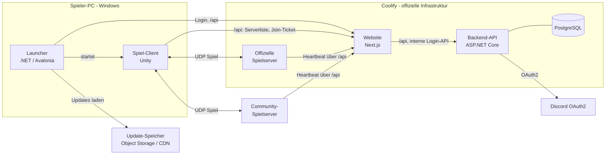
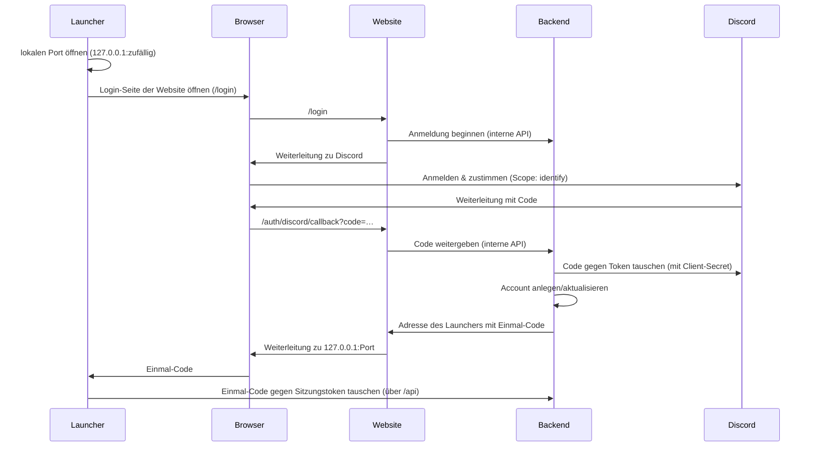

# Ace of Spades 2 – Architektur

> Status: Entwurf. Entscheidungen, die noch offen sind, stehen als **Offen** markiert.

## 1. Überblick



Website und Backend teilen sich eine Adresse: Die Website zeigt die Seiten und reicht alles unter `/api` an das Backend durch. Launcher, Spiel und Spielserver brauchen deshalb nur diese eine Adresse.

| Komponente | Technik | Aufgabe |
|---|---|---|
| **Launcher** | .NET 10, Avalonia, Velopack | Discord-Login, Spiel installieren/aktualisieren, Spiel starten |
| **Client** | Unity 6, URP | Darstellung, Eingabe, Sound, UI, Server-Browser, Vorhersage der eigenen Bewegung |
| **Spielserver** | .NET 10 Konsolenanwendung | Autoritative Spiellogik: Bewegung, Treffer, Blöcke, Punkte |
| **Website** | Next.js 16 (TypeScript) | Startseite, Seiten der Discord-Anmeldung, reicht `/api` an das Backend durch |
| **Backend-API** | ASP.NET Core (.NET 10) + PostgreSQL | Accounts, Discord-Tausch, Sitzungen, Server-Browser (Master-Server), Join-Tickets |
| **Shared-Library** | .NET Standard 2.1, C# 9 | Code, den Client **und** Server gemeinsam nutzen |
| **Update-Speicher** | S3-kompatibler Object Storage | Spieldateien und Update-Manifest |

## 2. Monorepo-Struktur

```
aceofspades2/
├─ client/                     Unity-Projekt
├─ server/
│  ├─ AoS2.Server/             Dedizierter Spielserver
│  └─ AoS2.Server.Tests/
├─ backend/
│  ├─ AoS2.Backend/            Web-API: Login, Accounts, Server-Browser
│  └─ AoS2.Backend.Tests/
├─ launcher/
│  ├─ AoS2.Launcher/           Avalonia-Fenster, Velopack-Self-Update
│  └─ AoS2.Launcher.Tests/
├─ libs/
│  ├─ AoS2.Shared/             Protokoll, Voxel-Welt, Bewegung, Spielregeln
│  ├─ AoS2.Shared.Tests/
│  ├─ AoS2.Updates/            Update-Manifest, Dateivergleich, Download (Launcher + ManifestBuilder)
│  ├─ AoS2.Updates.Tests/
│  ├─ AoS2.Contracts/          Datenformate der Backend-API (DTOs), auch als Unity-Package
│  ├─ AoS2.JoinTickets/        Join-Tickets ausstellen (Backend) und prüfen (Spielserver)
│  ├─ AoS2.JoinTickets.Tests/
│  └─ AoS2.Net/                Netzwerkverbindung des Clients (LiteNetLib), auch als Unity-Package
├─ tools/
│  ├─ AoS2.MapConverter/       MagicaVoxel (.vox) → .aos2map
│  ├─ AoS2.ManifestBuilder/    Erzeugt das Update-Manifest
│  ├─ AoS2.ManifestBuilder.Tests/
│  └─ release/                 Release-Skripte: Unity-Build, Upload, Velopack
├─ data/                       blocks.json, movement.json, player_rig.json, combat.json, weapons.json (classes.json ab M8)
├─ maps/                       Map-Quellen und gebaute Maps
├─ assets-src/                 Quelldateien der Assets (siehe docs/assets.md)
├─ deploy/                     Docker-/Compose-Dateien für Coolify
├─ web/                        Website (Next.js): Startseite, Discord-Login, Durchreichen von /api
├─ docs/
├─ .github/workflows/
├─ Directory.Build.props
├─ global.json                 Festgelegte .NET-SDK-Version
└─ AoS2.slnx
```

### Shared-Library in Unity einbinden

- `libs/AoS2.Shared` ist gleichzeitig ein normales .NET-Projekt (`.csproj`) **und** ein Unity-Package (`package.json` + `.asmdef`).
- Unity bindet sie über `client/Packages/manifest.json` ein: `"com.aos2.shared": "file:../../libs/AoS2.Shared"`.
- Damit Unity nicht über `bin/`- und `obj/`-Ordner stolpert, landen alle .NET-Build-Ausgaben zentral in `artifacts/` (`UseArtifactsOutput` in `Directory.Build.props`).
- Regeln für Shared-Code: **keine** Unity-Referenzen, maximal C# 9, nur .NET Standard 2.1-APIs (Grenze, solange Unity auf Mono läuft).

### Spieldaten (`data/`)

Block-, Klassen- und Waffen-Definitionen liegen als JSON in `data/`. Der Server liest sie direkt, der Client bekommt sie beim Build nach `StreamingAssets` kopiert. Der Server ist maßgeblich – der Client nutzt die Daten nur für Anzeige und Vorhersage.

## 3. Netzwerk

### Grundprinzip: Der Server hat immer recht

Der Client schickt nur **Eingaben** und **Absichten** („ich drücke W“, „ich will Block X abbauen“, „ich schieße in Richtung Y“). Der Server prüft alles, berechnet das Ergebnis und schickt den Zustand zurück. So kann ein manipulierter Client nicht einfach behaupten, er habe jemanden getroffen.

### Technik

- **Transport:** LiteNetLib (UDP), Standard-Port `32887`.
- **Simulation:** 60 Ticks/Sekunde auf dem Server.
- **Snapshots:** ca. 30/Sekunde an die Clients.

| Nachrichtentyp | Kanal | Beispiel |
|---|---|---|
| Eingaben | unzuverlässig, jeweils mit den letzten Eingaben als Puffer | Bewegung, Blickrichtung, Feuern |
| Snapshots | unzuverlässig, nur der neueste zählt (Sequenced) | Positionen aller Spieler, Fallhöhe fallender Gruppen |
| Weltänderungen | zuverlässig, geordnet | Block entfernt/gesetzt, Blockgruppe fällt |
| Spielereignisse | zuverlässig, geordnet | Treffer, Kill, Schuss eines anderen, Geschoss gestartet/explodiert, Blockschaden, Spieler beigetreten |

Serialisierung: eigene, schlanke Binär-Serializer in `AoS2.Shared` (keine Reflection, gut testbar).

### Umsetzung (seit M4)

| Teil | Wo | Aufgabe |
|---|---|---|
| Protokoll | `AoS2.Shared/Net` (`NetWriter`, `NetReader`, `Messages.cs`) | Nachrichten Feld für Feld schreiben/lesen; alles aus dem Netz wird geprüft, Fehler sind immer `ProtocolException` |
| Client-Logik | `AoS2.Shared/Net/Client` (`ClientSession`, `ClientPrediction`, `InterpolationBuffer`, `PredictedBlocks`, `NetFallingGroups`, `NetProjectiles`) | Vorhersage (Bewegung und Waffen), Abgleich, Interpolation, vorab gezeigte Blockänderungen, Geschossbahnen – ohne Unity und ohne Transport, deshalb in .NET testbar |
| Transport Client | `libs/AoS2.Net` (`NetClient`) | LiteNetLib-Verbindung; reicht Bytes an die `ClientSession` weiter. Unity-Package und .NET-Projekt wie `AoS2.Shared` |
| Server | `server/AoS2.Server` (`Match`, `Match.Combat`, `GameServer`, `TicketCheck`) | `Match` ist die Simulation ohne Netzwerk-Code (Kampf in `Match.Combat.cs`), `GameServer` hängt sie an LiteNetLib |

`AoS2.Shared` kennt LiteNetLib nicht. **LiteNetLib** (2.1.4) kommt im Server und in `AoS2.Net` als NuGet-Paket. In Unity liegt es als Quellcode eingebettet in `client/Packages/com.revenantx.litenetlib`, wie der Autor es für Unity empfiehlt (Quellcode statt DLL). Eingebettet, weil Unity 6 Pakete aus fremden Registries wie OpenUPM bei jedem Start als unsigniert meldet und ein Git-Link nicht geht (im LiteNetLib-Repository fehlen die `.meta`-Dateien). Neue Version: `./tools/dev/update-litenetlib.ps1 -Version x.y.z` (vergleicht mit dem GitHub-Tag), dann dieselbe Version in beiden `.csproj` eintragen.

**Ablauf eines Ticks:** Der Client rechnet jeden Tick sofort (Vorhersage), merkt sich Eingabe und Ergebnis und schickt die noch unbestätigten Eingaben (bis 16) unzuverlässig an den Server. Der Server rechnet pro Spieler höchstens eine Eingabe pro Tick im Mittel (Guthaben von 8 für Ruckler; wer schneller sendet, dem werden Eingaben verworfen). Alle 2 Ticks schickt er jedem Client einen Snapshot: den eigenen Zustand in voller Genauigkeit plus „letzte verarbeitete Eingabe k“, andere Spieler gerundet. Der Client setzt sich auf den Server-Zustand nach k und rechnet die neueren Eingaben neu; weil der Bewegungscode deterministisch ist, kommt ohne äußere Einflüsse bitgenau dasselbe heraus. Eine echte Korrektur (z. B. ein anderer Spieler hat einen Block weggenommen) übernimmt die Simulation sofort, die Kamera gleitet in wenigen Bildern hinterher.

**Andere Spieler** zeigt der Client 6 Ticks (100 ms) hinter der geschätzten Server-Zeit, zwischen zwei Snapshots interpoliert. Die Server-Zeit schätzt er aus den Tick-Nummern der Snapshots (`ServerClock`).

**Blockänderungen:** Der Client prüft die Regeln vorab, zeigt die Änderung sofort und schickt die Absicht zuverlässig mit dem Eingabe-Tick, nach dem sie passiert ist. Der Server prüft sie mit dem Zustand des Spielers genau zu diesem Tick (Pause seit der letzten Aktion, Strahl vom Auge muss genau diesen Block treffen, Reichweite, Regeln aus `BlockEditing`, beim Bauen kein Spieler im Weg), verteilt angenommene Änderungen an alle und antwortet dem Absender. Lehnt er ab, nimmt der Client seine Vorhersage zurück.

Lokal testen und Server-Optionen: [server.md](server.md).

### Begriffe (für den Einstieg)

- **Client-Vorhersage (Prediction):** Der Client bewegt den eigenen Spieler sofort, ohne auf den Server zu warten. Dafür nutzt er denselben Bewegungscode wie der Server (`AoS2.Shared`).
- **Abgleich (Reconciliation):** Weicht die Server-Position von der vorhergesagten ab, korrigiert der Client sich und spielt die noch nicht bestätigten Eingaben erneut ab.
- **Interpolation:** Andere Spieler werden leicht verzögert und flüssig zwischen zwei Snapshots dargestellt.
- **Lag-Ausgleich (Lag Compensation):** Bei einem Schuss spult der Server die Positionen der anderen Spieler auf den Zeitpunkt zurück, den der Schütze gesehen hat, und prüft dort den Treffer.

### Trefferzonen (Hitboxen)

Ziel: Die Trefferzonen passen **immer exakt** zum sichtbaren Modell und seiner aktuellen Animation.

- **Eine Datenquelle:** `assets-src/tools/export-rig.mjs` liest das Blockbench-Modell und schreibt `data/player_rig.json`. Darin stehen die Knochen (Drehpunkte, Hierarchie), **jeder Würfel als Trefferbox** an seinem Knochen (mit Zone Kopf/Rumpf/Arm/Bein und Klasse bei Ausrüstung) und alle Animationen, mit Blockbenchs eigener Interpolation in 60 Bildern/Sekunde abgetastet. Das Skript wurde gegen Blockbench nachgemessen (gleiche Werte auf 0,001 px).
- **Ein Pose-Rechner für beide Seiten:** `AoS2.Shared` berechnet aus Animationszustand und Zeit die Pose. Der **Client** setzt damit die Knochen des sichtbaren Modells (kein Unity-Animator für den Spielerkörper, sonst könnten Bild und Trefferzonen abweichen). Der **Server** setzt damit die Trefferboxen. Beide rechnen also mit denselben Zahlen.
- **Animationszustand ist Spielzustand:** Welche Animation läuft, seit wann und wie sie überblendet wird, folgt fest aus Werten, die der Server ohnehin kennt (Haltung, Geschwindigkeit, am Boden/in der Luft, Zeitpunkt des Wechsels, Blickwinkel). Keine Zufallswerte, keine nur im Client bekannten Effekte an Knochen mit Trefferboxen.
- **Lag-Ausgleich spult auch die Pose zurück:** Der Server speichert pro Tick den Animationszustand jedes Spielers und prüft einen Schuss gegen die Pose, die der Schütze gesehen hat.
- **Prüfung des Schusses:** Strahl gegen gedrehte Quader (OBB) der Trefferboxen des Gegners, zuerst grob gegen eine umschließende Kugel.
- **Bewegungs-Kollision** mit der Welt bleibt ein einfacher Quader (sonst ruckelt die Bewegung an Kanten). Seine Höhe je Haltung kommt ebenfalls aus dem Modell (`stances` in `player_rig.json`): z. B. geduckt ca. 1,47 Blöcke, mit Helm ca. 1,55.
- **Umsetzung (seit M5):** `AoS2.Shared/Rig` – `PlayerRig` liest `player_rig.json`, `PlayerAnimator` führt den Animationszustand (`AnimationState`: Animation, Start-Tick, vorige Animation, Überblendung über 8 Ticks), `PlayerPose` rechnet die Knochenmatrizen und die Trefferboxen in der Welt, `Combat/Geometry` prüft Strahl gegen Kugel und OBB. Getestet gegen die Werte, die `export-rig.mjs --check` direkt aus den Blockbench-Keyframes rechnet.
- **Feste Regeln zusätzlich zu den Blockbench-Animationen:** Der Kopf neigt sich mit dem Blick (75 %, höchstens 60°). Mit einer Waffe in der Hand zeigen beide Arme in Blickrichtung (Zielhaltung, gleicht eine Neigung des Körpers aus). Beides rechnet `PlayerPose` auf beiden Seiten gleich. Eine Zielhaltung aus Blockbench kann sie später ersetzen.
- **Modell und Welt:** Blockbench rechnet rechtshändig mit Blick nach −z, Unity linkshändig mit Blick nach +z. Der Übergang ist eine Spiegelung von z, nicht eine halbe Drehung (sonst wäre der rechte Arm links): `PlayerPose.ModelToWorld`. Der Client baut das sichtbare Modell aus denselben Würfeln (`player_rig.json` enthält dafür auch die Texturkoordinaten jeder Seite) und setzt die Knochen jedes Bild aus der `PlayerPose`.
- **Schadensfaktoren je Zone** (Entscheidung M5, `data/combat.json`): Kopf ×2, Rumpf ×1, Arme ×0,67, Beine ×0,67 (wie das Original: ein Kopfschuss mit 50 Grundschaden tötet). Gilt für Hitscan-Treffer; Explosionen zählen ohne Zone.
- **Waffe in der Hand** hat keine Trefferzone (Entscheidung M5): Sie wird im Client an die rechte Hand gehängt, ist aber kein Würfel des Spielermodells.
- **Offen:** Zählen dünne Ausrüstungsteile (Klassen ab M8) als Treffer? In M5 trägt niemand Ausrüstung (Klasse „none“).

### Kampf (seit M5)

Werte stehen in `data/combat.json` (Leben, Respawn-Zeit, Selbstschaden, Zonenfaktoren, Wechselzeit, wie weit der Lag-Ausgleich zurückspult) und `data/weapons.json` (Waffen in Platz-Reihenfolge; Platz 1 ist immer der Spaten). Client und Server lesen dieselben Dateien (`CombatSettings`).

| Teil | Wo | Aufgabe |
|---|---|---|
| Waffen-Simulation | `AoS2.Shared/Combat/WeaponState.cs` (`WeaponSim`) | Wechsel, Feuerpause, Magazin, Nachladen: deterministisch aus den Eingaben, wie die Bewegung |
| Geschosse | `AoS2.Shared/Combat/Projectiles.cs` | Flug je Tick, Strahl gegen die Welt, Abprallen (Granate), Explosion bei Aufprall (Rakete) oder Zündzeit |
| Explosionen | `AoS2.Shared/Combat/Explosions.cs`, `Voxels/BlockDamage.cs` | Schaden an Blöcken und Spielern, linear zum Rand hin weniger, Spieler nur mit Sichtlinie |
| Server | `server/AoS2.Server/Match.Combat.cs` | Schuss prüfen (mit Lag-Ausgleich), Schaden, Tod, Respawn, Geschosse, Explosionen |
| Client | `ClientSession` (Leben, Geschosse, Blockschaden, `CombatEvent`), Unity: `PlayerModel`, `WeaponView`, `CombatEffects`, `BlockCracksView`, `Hud` | Anzeige und Effekte |

**Schießen ist eine Eingabe.** Feuern, Nachladen und die gewählte Waffe stecken in `PlayerInput` (Kanal Eingaben, mit den Wiederholungen der letzten Ticks). Client (Vorhersage) und Server rechnen daraus mit `WeaponSim` dasselbe: Der Client zeigt Mündungsfeuer, Leuchtspur und Munition sofort, der Server weiß aus derselben Rechnung, in welchem Eingabe-Tick ein Schuss fällt. Die Waffen des Spielers stehen im Snapshot wie die Position und werden genauso abgeglichen.

**Lag-Ausgleich, Schritt für Schritt:**
1. Der Client zeigt andere Spieler 100 ms in der Vergangenheit (Interpolation). Dazu kommt die Laufzeit der Snapshots. Wer schießt, zielt also auf eine Stelle, an der der Gegner auf dem Server schon nicht mehr steht.
2. Mit der Feuern-Eingabe schickt der Client deshalb den Server-Tick mit, den er gerade zeigt (`ViewTick`, auf 1/256 Tick genau).
3. Der Server merkt sich für jeden Spieler und jeden Tick genau das, was in den Snapshots über ihn steht (`ServerPlayer.RecordView`): Position, gerundeter Blick, Haltung, Waffe, Animationszustand. Der Verlauf reicht gut eine Sekunde zurück.
4. Beim Schuss baut er daraus das Bild nach, das der Schütze gesehen hat: dieselbe Interpolation zwischen zwei Snapshots (`PlayerSnapshot.Lerp`, gemeinsamer Code), dieselbe Pose zum selben Zeitpunkt (`PlayerPose`).
5. Gegen diese zurückgespulten Trefferboxen prüft er den Strahl vom Auge des Schützen (Stand und Blick aus genau diesem Eingabe-Tick). Blöcke prüft er in der aktuellen Welt; der nächste Treffer gewinnt, ein Block davor hält den Schuss auf.
6. Zurückgespult wird höchstens `maxRewindSeconds` (0,5 s), damit ein Client mit riesigem Ping nicht um Ecken treffen kann.

Folge: Wer auf das zielt, was er sieht, trifft. Der Getroffene kann dabei schon ein Stück hinter einer Ecke sein („um die Ecke gestorben“), das ist der übliche Preis. Ein Test spielt das mit 200 ms Ping durch (`CombatNetTests`).

**Leben, Tod, Respawn:** Der Server führt die Lebenspunkte. Schaden, Kill und Schüsse anderer kommen als zuverlässige Spielereignisse (`PlayerDamaged`, `PlayerKilled`, `ShotFired`), die eigenen Lebenspunkte, der Respawn-Countdown und ob andere leben zusätzlich im Snapshot. Tote rechnen weiter Bewegung und Blick, aber ohne Tasten (Client und Server gleich). Nach `respawnSeconds` setzt der Server den Spieler an den nächsten Spawnpunkt, mit vollem Leben und voller Munition; der Client springt beim Abgleich mit. Ein Zähler `Life` im Snapshot verhindert, dass andere Clients zwischen Todesort und Spawn interpolieren.

**Geschosse** (Granate, Rakete) fliegen nur auf dem Server. Start (Ort, Geschwindigkeit, Tick) und Explosion kommen als Ereignisse; dazwischen rechnet der Client die Bahn mit demselben Code zur Anzeige nach, so braucht ein Geschoss keinen Platz im Snapshot. Raketen explodieren auch am Kollisionsquader eines Spielers (nicht am Schützen). Geschosse haben keinen Lag-Ausgleich: Sie fliegen in Server-Zeit.

**Explosionen:** Zuerst Spieler (Sichtlinie zu Füßen, Brust oder Kopf in der Welt vor der Explosion), dann Blöcke im `blockRadius`: Ihr Schaden zählt zum Blockschaden, zerstörte Blöcke verschwinden, danach fallen Gruppen ohne Verbindung zum Boden (eine gemeinsame Suche für alle zerstörten Blöcke). Eigene Explosionen schaden mit `selfDamage` (Entscheidung M5: voller Schaden).

**Snapshot-Größe:** Ein anderer Spieler braucht bis zu 28 Byte. Bis etwa 33 Spieler passen alle in ein Paket (unter 1000 Byte); bei mehr Spielern kommen sie reihum dran und werden über längere Lücken interpoliert (der Lag-Ausgleich ist dann leicht ungenauer). Für 48 Spieler wären kompaktere Positionen nötig (M9).

### Team Deathmatch (seit M6)

| Teil | Wo | Aufgabe |
|---|---|---|
| Zonen | `AoS2.Shared/Maps/MapZones.cs` | Welche Blöcke änderbar sind, wer in einer Spawnzone steht, welche Zonen für ein Team Wände sind, wo ein Strahl auf eine Zonengrenze trifft (Abschnitt 5, Zonen) |
| Match | `server/AoS2.Server/Match.Teams.cs` | Teamwahl und Ausgleich, Punkte, Matchende, Zeitlimit, Neustart |
| Regeln | `MatchSettings` aus der Server-Config (`ServerOptions`, Datei `server.json`) | Spieler pro Team, Punkteziel, Zeitlimit, Pause nach dem Matchende, Teambeschuss |
| Protokoll | `AoS2.Shared/Net/MatchMessages.cs`, Ereignisse 14–17 | `TeamSelectRequest` (Client → Server), `TeamChanged`, `PlayerStats`, `MatchState` (`MatchInfo`), `TeamDenied` |
| Client | `ClientSession` (`Team`, `Match`, `Kills`/`Deaths`, `RequestTeam`), Unity: `GameClient` (Team-Menü), `Hud`, `RemotePlayersView` (Teamfarben) | Anzeige |

**Ablauf, Schritt für Schritt:**
1. Wer beitritt, ist Zuschauer: Team `None`, tot, ohne Respawn-Zeit, über der Mitte der Map. Der Client öffnet das Team-Menü.
2. Der Client schickt `TeamSelectRequest` (zuverlässig). Der Server prüft die Ausgleichsregel und antwortet allen mit `TeamChanged` oder nur dem Absender mit `TeamDenied` (voll, unausgeglichen, schon drin). Ein Zuschauer spawnt sofort an einem Spawnpunkt seines Teams (reihum); wer wechselt, stirbt ohne Tod in der Statistik und spawnt nach der Respawn-Zeit im neuen Team.
3. Ein Kill eines Gegners zählt für den Schützen und sein Team. Danach gehen `PlayerStats` (Kills/Tode von Opfer und Schütze) und `MatchState` (Punkte) an alle. Selbstmord und Teamkill geben keinen Punkt.
4. Erreicht ein Team das Punkteziel oder läuft das Zeitlimit ab, wird die Phase `Ended`: `MatchState` mit Sieger und dem Server-Tick des Neustarts. Server **und** Client werten dann alle Tasten als nicht gedrückt (wie bei Toten), Blockänderungen lehnt der Server mit `MatchOver` ab, Schaden gibt es keinen.
5. Neustart: Der Server schickt zuerst `MatchState` mit der nächsten Matchnummer (der Client vergisst daraufhin Geschosse, fallende Gruppen, Risse, Kills und Tode), dann für jeden seit Matchbeginn geänderten Block den Stand aus der Map-Datei als `BlockSet`. Danach spawnen alle Spieler mit Team neu. So braucht der Neustart keine eigene Nachricht für die Welt und funktioniert für alle, die gerade verbunden sind.
6. Wer später beitritt, bekommt bei der Synchronisation zuerst `MatchState`, dann wie bisher die Welt und für jeden anderen Spieler `PlayerJoined`, `TeamChanged` und `PlayerStats`.

Ohne Spieler in Teams steht die Uhr des Zeitlimits (ein leerer Server spielt keine Matches durch). Teams werden beim Neustart nicht gemischt; wer geht, hinterlässt eine Lücke, die neue Spieler über das Menü füllen.

**Protokollversion 3** (M6): neue Nachricht und neue Ereignisse, `Team` als Byte (0 = keins, 1 = Blau, 2 = Grün).

**Last (gemessen mit `tools/AoS2.LoadTest`: Bots über UDP auf localhost, Server im selben Prozess, Release-Build, Entwicklungsrechner, je 20 s):**

| Spieler | Tick-Rate | Rechenzeit pro Tick Ø / 99 % / max | Snapshot Ø / max | Download pro Client | Upload Server gesamt |
|---|---|---|---|---|---|
| 8 | 60/s | 0,06 / 0,55 / 11,8 ms | 230 / 258 Byte | 8,5 kB/s (68 kbit/s) | 0,56 Mbit/s |
| 16 | 60/s | 0,05 / 0,68 / 3,3 ms | 421 / 482 Byte | 14,8 kB/s (119 kbit/s) | 1,9 Mbit/s |
| 32 | 60/s | 0,15 / 1,4 / 6,0 ms | 805 / 930 Byte | 27,7 kB/s (222 kbit/s) | 7,3 Mbit/s |

Die Rechenzeit ist kein Problem (Budget 16,7 ms pro Tick). Die Bandbreite wächst mit dem Quadrat der Spielerzahl (jeder bekommt jeden), bei 32 Spielern also gut 7 Mbit/s Upload für den Server. Für einen Server im Rechenzentrum ist das wenig, für einen Heim-Anschluss viel. Kompaktere Positionen und weniger Snapshots für ferne Spieler sind Teil von M9. Die Bots kämpfen dabei ständig (gut 2 Kills/s), das ist mehr als im echten Spiel.

## 4. Voxel-Welt

### Daten

- Welt in **Chunks à 32 × 32 × 32** Blöcken.
- Pro Block eine **Blocktyp-ID** (1 Byte → bis zu 255 Blocktypen + Luft).
- Blockschaden wird nur für beschädigte Blöcke gespeichert (die meisten Blöcke sind unbeschädigt).
- Eine 512 × 512 × 64-Map belegt so rund 16 MB im Speicher.

Code: `AoS2.Shared/Voxels` (`VoxelWorld`, `BlockRegistry`, `VoxelRaycast`). Blocktypen stehen in `data/blocks.json`; Maps verweisen über den Namen auf sie (nicht über die ID), damit sich IDs ändern dürfen.

### Darstellung (nur Client)

- Ein Mesh pro Chunk. Gleiche, nebeneinanderliegende Flächen werden zu großen Flächen zusammengefasst (Greedy Meshing).
- Texturen liegen in einem `Texture2DArray`; dadurch funktionieren zusammengefasste Flächen mit wiederholten Texturen. Der Client baut das Array beim Laden aus den PNGs, die `blocks.json` nennt (Editor: `assets-src/textures/blocks`, Build: `StreamingAssets`). Varianten einer Seite liegen als aufeinanderfolgende Ebenen im Array; der Shader wählt je Block eine davon aus der Blockposition, so bleiben auch zusammengefasste Flächen abwechslungsreich.
- Meshes werden mit Unity Jobs + Burst erzeugt, alle geänderten Chunks parallel auf allen Kernen. Änderungen am Chunkrand bauen den Nachbarchunk mit.
- Code: `client/Assets/Scripts/World` (`ChunkMeshJob`, `WorldRenderer`), Shader `client/Assets/Shaders/Voxel.shader`.

### Bewegung

- Ein Tick = ein Aufruf von `PlayerMovement.Step` (`AoS2.Shared/Movement`), 60 Ticks/s. Der Client rechnet in festen Ticks und interpoliert die Anzeige dazwischen; der Server rechnet mit demselben Code.
- Deterministisch: gleicher Zustand + gleiche Eingabe ergibt bitgleich dasselbe Ergebnis. Dafür nur float-Grundrechenarten und eigene Sinus/Kosinus-Näherungen (`DetMath`), kein `System.Numerics`, keine Zufallswerte.
- Kollision: senkrechter Quader, 0,8 Blöcke breit, Höhe je Haltung aus `stances` in `data/player_rig.json` (stehend 1,90, geduckt 1,47). Bewegt wird Achse für Achse; am Boden steigt man Kanten bis 1 Block ohne Sprung hoch. Kartenränder und Kartenboden sind feste Wände.
- Werte (Geschwindigkeiten, Sprunghöhe, Schwerkraft) stehen in `data/movement.json`.

### Zerstören und Bauen

1. Client schickt eine Absicht (abbauen, schießen, bauen).
2. Server prüft: Reichweite, Sichtlinie, Zone, Munition/Blockvorrat, Cooldown.
3. Server ändert die Welt und schickt die Änderung an alle Clients.

Der Client zeigt Abbauen und Bauen vorab an und nimmt die Änderung wieder weg, falls der Server ablehnt (Einzelheiten: Abschnitt 3, Umsetzung).

**Blockschaden (seit M5):** Kugeln (`blockDamage` je Treffer) und Explosionen ziehen Lebenspunkte ab (`health` in `blocks.json`). Gespeichert wird nur für beschädigte Blöcke (`BlockDamage`); ändert sich ein Block, ist sein Schaden vergessen. Clients bekommen den Schaden als Stufe 1 … 255 und zeigen vier Stufen Risse. Wer später beitritt, bekommt alle beschädigten Blöcke mit. Zerstörte Blöcke verschwinden wie beim Abbauen und können Gruppen fallen lassen.

Die Regeln (Reichweite 5 Blöcke, 0,2 s Pause, unzerstörbare Blöcke, nicht in den eigenen Quader bauen) stehen in `AoS2.Shared/Voxels/BlockEditing.cs`. Client (vorab) und Server (verbindlich) prüfen dieselben Regeln; nur der Server prüft zusätzlich Sichtlinie, Pause und andere Spieler im Weg. Seit M6 gehören die Zonen dazu (`ProtectedZone`, Abschnitt 5) und nach dem Matchende `MatchOver`. Ein Blockvorrat ist noch offen.

### Fallende Blöcke

1. Nach jedem entfernten Block prüft der Server die Nachbarblöcke: Hängen sie noch (über andere Blöcke) mit dem Boden zusammen? Das ist eine Flutfüllung (Flood Fill) mit Obergrenze. Verbunden heißt: über gemeinsame Seiten. Boden ist die unterste Blockschicht. Die Suche geht zuerst nach unten und bricht ab, sobald sie den Boden erreicht; findet sie mehr als 8192 Blöcke, gilt die Gruppe als verankert (`FloatingBlocks`).
2. Eine Gruppe ohne Verbindung wird aus der Welt entfernt und wird zu einem **fallenden Objekt**.
3. Das Objekt fällt senkrecht und wird beim Aufprall wieder als Blöcke in die Welt gesetzt (`FallingBlocks`, gleiche Schwerkraft wie der Spieler).
4. Clients bekommen Start (mit allen Blöcken) und Aufprall als zuverlässige Ereignisse, die Fallhöhe dazwischen per Snapshot, und interpolieren sie (`NetFallingGroups`, nur 2 Ticks verzögert, damit der Aufprall nicht springt). Offline rechnet der Client die Gruppen selbst.

**Offen:** Schaden beim Aufprall (für Blöcke und Spieler).

## 5. Maps

### Format `.aos2map`

| Abschnitt | Inhalt |
|---|---|
| Header | Kennung `AOS2MAP\0`, Format-Version (uint16, derzeit 1), Abmessungen x/Höhe/z (je int32) |
| Block-Palette | Anzahl (uint8), dann je Eintrag der Blocktyp-Name aus `data/blocks.json`; Map-interne ID 1 = erster Eintrag, 0 = Luft |
| Chunk-Daten | Länge (int32), dann Deflate-komprimiert alle Chunks (Reihenfolge y, z, x), jeder als Lauflängen: Länge (Varint) + Map-interne ID |
| Metadaten (JSON) | Länge (int32) + UTF-8: Name, Kampfzone, Spawnzonen, Spawnpunkte |

Alle Zahlen Little Endian. Lesen und Schreiben: `AoS2.Shared/Maps/MapFile.cs`. Die Testmap (128 × 64 × 128) ist so rund 7 KB groß.

### Erstellung

1. Map in **MagicaVoxel** bauen (eine Welt kann aus mehreren Modellen bestehen).
2. Mit `AoS2.MapConverter` umwandeln. Eine Zuordnungsdatei legt fest, welche Palettenfarbe welcher Blocktyp ist.
3. Zonen und Spawnpunkte erst per JSON, später mit einem Unity-Editor-Tool einzeichnen.

Anleitung mit allen Optionen: [maps.md](maps.md).

### Verteilung

- Maps werden über den Launcher mit dem Spiel ausgeliefert.
- Beim Beitritt schickt der Server: Map-ID + Prüfsumme + alle Änderungen seit Matchbeginn.
- **Offen:** Sollen Community-Server eigene Maps nutzen können? Dann muss der Client fehlende Maps vom Server herunterladen.

### Zonen

Kampf- und Spawnzonen sind Quader in den Metadaten. Der Server erzwingt:
- keine Blockänderungen in Spawnzonen (auch nicht durch Explosionen)
- Gegner kommen nicht hinein (Kollision im gemeinsamen Bewegungscode, damit die Vorhersage sie kennt)
- keine Waffenbenutzung im Spawn, Geschosse werden an der Zonengrenze gestoppt

**Umsetzung (seit M6):** Alle Regeln stehen in `AoS2.Shared/Maps/MapZones.cs` und werden auf beiden Seiten mit demselben Code gerechnet:

| Regel | Wie |
|---|---|
| Blöcke | `CanEditBlock`: nur in der Kampfzone (ohne Kampfzone überall) und nie in einer Spawnzone. Gilt für Abbauen/Bauen (`BlockEditing`, Ergebnis `ProtectedZone`), Gewehrschäden und Explosionen (`Explosions.DamageBlocks`). Unveränderliche Blöcke verankern schwebende Gruppen wie der Boden (`FallingBlocks.Anchor`), sonst könnte man den Spawn „von außen“ zum Einsturz bringen. |
| Gegner | `PlayerMovement.Step(…, barriers)`: Die Spawnzone des Gegners zählt für die Kollision wie feste Blöcke (`BarriersFor(team)`). Weil der Bewegungscode deterministisch und gemeinsam ist, sagt der Client die Wand richtig voraus, es gibt keine Korrektur. Wer schon in der Zone steckt (Teamwechsel), für den zählt sie nicht, bis er draußen ist. |
| Waffen | `WeaponSim.Step(…, blocked)`: Steht der Fußpunkt in einer Spawnzone, zählt Feuern als nicht gedrückt (Wechseln und Nachladen gehen). Client und Server rechnen es aus derselben Position. |
| Schüsse | Hitscan: `MapZones.Raycast` kürzt den Strahl an der ersten Zonengrenze (die Zone, in der der Schütze steht, zählt nicht). Geschosse: `ProjectileSim.Step(…, zones)` behandelt Spawnzonen wie Wände (Rakete explodiert, Granate prallt ab), auch in der Bahnberechnung des Clients. |
| Schaden | Wer mit dem Fußpunkt in einer Spawnzone steht, bekommt keinen Schaden (auch nicht von einer Explosion an der Grenze). |

Eine Spawnzone sollte bis zur Höhe der Map reichen: Für Gegner ist sie ein fester Quader, auf dem sie sonst stehen könnten. Der Test `TestMap_HasSpawnZonesAndPointsForTwoFullTeams` prüft das für die Testmap (16 Spawnpunkte pro Team).

## 6. Accounts & Discord-Login

### Ablauf im Launcher



- Die Seiten im Browser zeigt die Website; Konten, Discord-Tausch und Sitzungen bleiben im Backend (seit M2.1, vorher zeigte das Backend die Seiten selbst).
- Das Discord-Client-Secret liegt **nur im Backend**, nie im Launcher, Spiel oder in der Website.
- Website und Backend sprechen über eine interne API mit gemeinsamem Schlüssel; die Website reicht sie nicht nach außen durch.
- Der Einmal-Code ist zusätzlich mit PKCE (`code_challenge`/`code_verifier`) und einem Cookie an Launcher und Browser gebunden.
- Der Launcher speichert das Sitzungstoken verschlüsselt (Windows DPAPI) und gibt es beim Start als Umgebungsvariable (`AOS2_SESSION_TOKEN`, nicht auf der Kommandozeile) an das Spiel weiter.
- Ohne Anmeldung kann man nicht spielen. Sind Website oder Backend kurz nicht erreichbar, reicht die gespeicherte Anmeldung.
- Einzelheiten, lokales Testen und Einrichtung: [backend.md](backend.md).

### Join-Tickets für Spielserver

Spielserver – auch Community-Server – bekommen **nie** das Sitzungstoken des Spielers.

1. Der Client fragt beim Backend ein **Join-Ticket** für einen bestimmten Server an.
2. Das Ticket ist ein kurzlebiges, vom Backend signiertes JWT (Account-ID, Name, Ziel-Server, ca. 60 Sekunden gültig).
3. Der Spielserver prüft die Signatur mit dem öffentlichen Schlüssel des Backends (`/api/.well-known/jwks.json`, Code in `libs/AoS2.JoinTickets`) und dass das Ticket noch nicht benutzt wurde.

Zum lokalen Testen ohne Backend gibt es **Entwicklungs-Tickets**, die das Spiel selbst ausstellt. Sie nimmt nur ein Server an, der ausdrücklich mit `--dev` gestartet wurde ([server.md](server.md#2-entwicklungsmodus)).

So kann ein Community-Server die Identität eines Spielers prüfen, ohne ihm Zugangsdaten anzuvertrauen.

## 7. Server-Browser & Self-Hosting

- Spielserver melden sich alle ~30 Sekunden beim Backend (Heartbeat: Name, Map, Spieler, Version, Port).
- Das Backend prüft beim ersten Heartbeat, ob der Server von außen erreichbar ist, und begrenzt Anmeldungen pro IP.
- Der Client lädt die Serverliste vom Backend und misst den Ping direkt zum Server.
- Server mit inkompatibler Protokollversion werden ausgeblendet.
- Self-Hoster bekommen den Server als **Windows-/Linux-Download** (GitHub Releases) und als **Docker-Image** (GitHub Container Registry), dazu eine Beispiel-Config.
- **Config-Datei (seit M6):** JSON mit Kommentaren, `server/AoS2.Server/server.example.json` liegt neben der exe. Ein Objekt mit flachen Einträgen (`name`, `port`, `map`, `playersPerTeam`, `scoreLimit`, `timeLimitMinutes`, `matchEndSeconds`, `friendlyFire`, `site`, `address`, `dev`, optional `data`/`maps`), Start mit `--config server.json`; Werte auf der Kommandozeile gelten vor der Datei. Unbekannte Einträge sind ein Fehler (gegen Tippfehler). So kann ein Docker-Image die Datei einfach einbinden, und M7 ergänzt nur Einträge (z. B. Heartbeat, Server-Schlüssel), ohne das Format zu ändern. `name` ist schon da, damit Server-Betreiber ihn jetzt setzen können.
- **Offen:** Brauchen Self-Hoster einen Server-Schlüssel aus ihrem Account (verhindert Spam in der Liste)?
- Community-Server sind nicht vertrauenswürdig. Sollte es später Statistiken/Ranglisten geben, zählen nur offizielle Server.

## 8. Launcher & Updates

1. Beim Start aktualisiert sich der Launcher selbst (Velopack).
2. Login prüfen bzw. Discord-Login anbieten.
3. `manifest.json` laden: Spielversion + Liste aller Dateien mit SHA-256-Prüfsumme und Größe.
4. Lokale Dateien vergleichen und nur geänderte oder fehlende Dateien laden (beim ersten Start: alle).
5. Prüfsummen kontrollieren, Spiel starten.

- **Update-Speicher: Cloudflare R2** (S3-kompatibel, keine Kosten für ausgehenden Traffic). Ein Bucket enthält das Spiel (`game/`) und die Velopack-Pakete des Launchers (`launcher/`).
- Spieldateien liegen **nach ihrer SHA-256 benannt** im Bucket (`game/objects/ab/ab12…`). Ein Release lädt nur neue Inhalte hoch und zuletzt das Manifest, dadurch sieht kein Launcher eine halb hochgeladene Version.
- Manifest-Datentypen, Vergleich und Download liegen in `libs/AoS2.Updates` (nicht in `AoS2.Shared`, weil Unity sie nicht braucht). `tools/AoS2.ManifestBuilder` und der Launcher nutzen sie gemeinsam.
- Den Spielordner wählt man beim ersten Start im Launcher; der Launcher selbst liegt immer in `%LocalAppData%`. Verschieben und Deinstallieren fassen nur Dateien an, die der Launcher installiert hat.
- Einrichtung, Release-Ablauf und lokales Testen: [release.md](release.md).
- Die `.exe` sollte mit einem Code-Signing-Zertifikat signiert werden, sonst warnt Windows SmartScreen.

## 9. Versionierung

- Eine gemeinsame Versionsnummer für alle Teile pro Release (`v0.3.0`), gesetzt per Git-Tag.
- Zusätzlich eine **Protokollversion** (Ganzzahl) in `AoS2.Shared`. Client und Server prüfen sie beim Verbinden.

## 10. Deployment (Coolify)

| Dienst | Art |
|---|---|
| Website | Docker-Container, HTTPS über den Coolify-Proxy, einzige öffentliche Adresse |
| Backend-API | Docker-Container ohne eigene Domain, nur über die Website erreichbar |
| PostgreSQL | Coolify-Datenbank |
| Offizielle Spielserver | Docker-Container mit **direkt freigegebenem UDP-Port** (der Coolify-Proxy leitet nur HTTP weiter) |

Konfiguration als Compose-Dateien in `deploy/`. Nach einem Release stößt die CI das Redeploy über den Coolify-Webhook an. Einrichtung: [backend.md](backend.md#44-coolify).

## 11. CI/CD (GitHub Actions)

| Auslöser | Schritte |
|---|---|
| Pull Request | .NET-Projekte bauen und testen (Shared, Server, Backend, Launcher, Tools); Website: Lint, Tests, Build; beide Docker-Images testweise bauen |
| Release-Tag | Unity-Client bauen (GameCI) → Manifest erzeugen → in den Update-Speicher hochladen |
| | Server als Download + Docker-Image veröffentlichen |
| | Launcher mit Velopack paketieren und veröffentlichen |
| | Images von Website und Backend nach ghcr.io, Coolify-Redeploy auslösen |

Für Unity-Builds in GitHub Actions braucht GameCI die Unity-Lizenz als Secret. Bis das eingerichtet ist, kann der Client lokal gebaut und per Skript hochgeladen werden (`tools/release/build-game.ps1`). Workflow: `.github/workflows/release.yml`, Einrichtung: [release.md](release.md).
