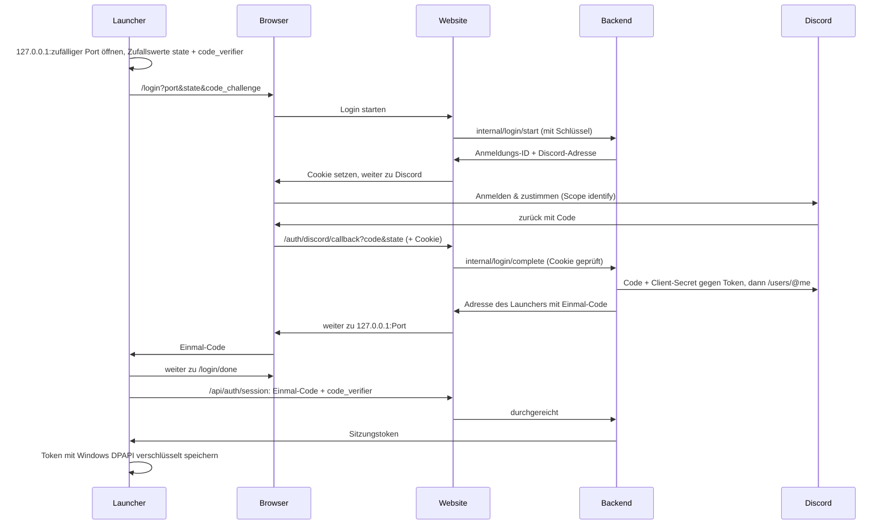

# Website, Backend und Discord-Login

Wie die Anmeldung funktioniert, wie man sie lokal ausprobiert und was man einmalig einrichten muss (Discord-App, Coolify, GitHub).

## 1. Überblick

Zwei Dienste, eine Adresse (z. B. `https://aos2.deine-domain.de`):

| Dienst | Technik | Aufgabe |
|---|---|---|
| **Website** (`web/`) | Next.js 16 (App Router, TypeScript, Tailwind) | Startseite, alle Seiten der Anmeldung im Browser, reicht `/api/*` an das Backend durch |
| **Backend** (`backend/AoS2.Backend`) | ASP.NET Core, PostgreSQL über EF Core | Konten, Discord-Tausch (mit Client-Secret), Sitzungen, Join-Tickets, Server-Browser |

Öffentlich erreichbar ist nur die Website. Launcher, Spiel und Spielserver kennen nur ihre Adresse; die API liegt darunter unter `/api`.

| Pfad | Wer ruft auf | Zweck |
|---|---|---|
| `GET /login` | Browser (vom Launcher geöffnet) | Anmeldung starten, weiter zu Discord |
| `GET /auth/discord/callback` | Browser (von Discord zurück) | Konto anlegen/aktualisieren, weiter zum Launcher |
| `/login/done`, `/login/error` | Browser (vom Launcher weitergeleitet) | Abschluss- und Fehlerseiten |
| `POST /api/auth/session` | Launcher | Einmal-Code gegen Sitzungstoken tauschen |
| `POST /api/auth/logout` | Launcher | Sitzung beenden |
| `GET /api/me` | Launcher, Spiel | Eigenes Konto (Name, Profilbild) |
| `POST /api/join-tickets` | Spiel (ab M4) | Kurzlebiges Ticket für einen bestimmten Spielserver |
| `GET /api/.well-known/jwks.json` | Spielserver (ab M4) | Öffentlicher Schlüssel zum Prüfen der Tickets |
| `GET /api/servers?protocol=3` | Spiel (ab M7) | Serverliste für den Server-Browser, öffentlich |
| `POST /api/servers/heartbeat` | Spielserver (ab M7) | Heartbeat; beim ersten prüft das Backend die Erreichbarkeit per UDP |
| `POST /api/servers/remove` | Spielserver (ab M7) | Abmelden beim Beenden |
| `GET /api/health` | Launcher, Coolify | Laufen Website, Backend und Datenbank? |
| `POST /api/internal/login/…` | nur die Website | Interne Login-API, mit gemeinsamem Schlüssel; die Website reicht sie nicht durch |

Die Datenformate (DTOs) liegen in `libs/AoS2.Contracts`. Backend, Launcher und Spiel nutzen dieselben Klassen; im Spiel ist die Bibliothek wie `AoS2.Shared` als Unity-Package eingebunden.

## 2. So läuft die Anmeldung



Die Schutzmaßnahmen, Schritt für Schritt erklärt:

- **Client-Secret nur im Backend.** Launcher und Spiel liegen beim Spieler; alles darin kann man auslesen. Auch die Website kennt das Secret nicht: Sie reicht den Discord-Code nur an das Backend weiter.
- **Interne Login-API mit Schlüssel.** Website und Backend teilen einen langen Zufallsschlüssel (`INTERNAL_API_KEY`). Ohne ihn lehnt das Backend `/api/internal/…` ab, und die Website reicht diese Pfade gar nicht erst durch. Sonst könnte jemand die Cookie-Prüfung der Website umgehen.
- **Nur `identify`.** Das Backend erfährt von Discord nur ID, Benutzername, Anzeigename und Profilbild, keine E-Mail-Adresse und keine Server.
- **Cookie im Browser.** Die Anmeldung gehört zu dem Browser, in dem sie gestartet wurde. Ein untergeschobener Discord-Rückkehr-Link aus einem fremden Browser wird abgelehnt.
- **PKCE** (`code_challenge`/`code_verifier`): Den Verifier kennt nur der Launcher. Fängt ein anderes Programm den Einmal-Code ab, kann es ihn ohne Verifier nicht eintauschen.
- **`state`**: Der Launcher nimmt nur die Weiterleitung seiner eigenen Anmeldung an.
- **Nur zum eigenen PC.** Die Website leitet am Ende ausschließlich an `http://127.0.0.1:<Port>/callback` weiter, nirgends sonst hin.
- **Kurze Fristen:** 10 Minuten für die Anmeldung, 2 Minuten für den Einmal-Code. Jeder Code gilt genau einmal.
- **Nur Prüfsummen in der Datenbank.** Sitzungstoken und Einmal-Codes stehen nur als SHA-256 in PostgreSQL. Wer die Datenbank liest, kann sich damit nicht anmelden.
- **Sitzungen** laufen nach 30 Tagen ohne Benutzung ab. Wer regelmäßig spielt, bleibt angemeldet. „Abmelden“ im Launcher löscht die Sitzung auch im Backend.
- **DPAPI:** Der Launcher speichert die Anmeldung in `%LocalAppData%\AceOfSpades2\session.dat`, verschlüsselt mit dem Windows-Konto. Kopiert jemand die Datei auf einen anderen PC, nützt sie ihm nichts.
- **Übergabe an das Spiel** als Umgebungsvariablen `AOS2_SESSION_TOKEN` und `AOS2_SITE_URL`, nicht auf der Kommandozeile. Die Kommandozeile zeigen Task-Manager, Prozesslisten und Absturzberichte an. Die Umgebung gilt nur für den Spielprozess, und das Spiel löscht die Variable nach dem Lesen.
- **Spielserver bekommen nie das Sitzungstoken**, sondern ab M4 ein Join-Ticket (Abschnitt 6).
- **Kein Referrer:** Die Website schickt `Referrer-Policy: no-referrer`, damit `state` und `code_challenge` nicht an Discord weitergegeben werden.

Ist die Website beim Start des Launchers nicht erreichbar, gilt die gespeicherte Anmeldung weiter („Anmeldeserver nicht erreichbar“ in den Einstellungen). Man kann also spielen, solange man sich einmal angemeldet hat.

## 3. Lokal entwickeln

Alles läuft auf dem eigenen PC, ohne Discord-App und ohne Passwörter. Drei Terminals:

```powershell
./tools/dev/dev-db.ps1                      # 1. Datenbank (einmal pro PC-Start)
dotnet run --project backend/AoS2.Backend   # 2. Backend auf http://localhost:5080
cd web; npm install; npm run dev            # 3. Website auf http://localhost:3000
```

### 3.1 Datenbank

`tools/dev/dev-db.ps1` legt beim ersten Mal mit der installierten PostgreSQL einen eigenen Datenbank-Cluster in `artifacts/dev-db` an und startet ihn auf `127.0.0.1:5433`. Benutzer `aos2`, kein Passwort; erreichbar nur vom eigenen PC. Die installierte PostgreSQL auf Port 5432 bleibt unberührt. Anhalten mit `-Stop`, komplett löschen mit `-Reset`.

### 3.2 Backend

Das Profil `dev-login` (Standard, siehe `backend/AoS2.Backend/Properties/launchSettings.json`) startet das Backend auf `http://localhost:5080` mit der Datenbank aus 3.1. Die Tabellen legt es beim Start selbst an. Statt zu Discord geht die Anmeldung auf eine **Entwicklungs-Login-Seite** der Website, auf der man einen beliebigen Namen eingibt. Das geht nur in der Development-Umgebung; auf dem Server verweigert das Backend den Start, falls es eingeschaltet ist.

### 3.3 Website

`npm run dev` liest `web/.env.development` (im Repo, ohne Geheimnisse): Backend auf `localhost:5080`, derselbe Entwicklungsschlüssel wie im Backend-Profil, Entwicklungs-Login an. Tests, Prüfung und Produktions-Build:

```powershell
cd web
npm test          # Vitest: Login-Regeln, Route Handler, Durchreichen der API
npm run lint
npm run build
```

### 3.4 Launcher und Spiel

```powershell
./tools/release/build-game.ps1 -Version 0.2.0      # einmal: Spiel bauen, lokaler Update-Speicher
$env:AOS2_SITE_URL = 'http://localhost:3000'
$env:AOS2_UPDATE_URL = "$PWD\artifacts\release"
$env:AOS2_DATA_DIR = "$PWD\artifacts\test-data"    # optional: nicht die echte Anmeldung überschreiben
dotnet run --project launcher/AoS2.Launcher
```

„Mit Discord anmelden“ öffnet den Browser mit der Entwicklungs-Login-Seite. Nach „Anmelden“ zeigt der Browser „Angemeldet“, der Launcher oben rechts den Namen, und nach „Spielen“ zeigt das Spiel „Angemeldet als …“.

### 3.5 Im Unity-Editor

Im Play-Modus gibt es keinen Launcher. Das Spiel liest dann die gespeicherte Anmeldung des Launchers (`%LocalAppData%\AceOfSpades2\session.dat`, oder der Ordner aus `AOS2_DATA_DIR`). Einmal im Launcher anmelden reicht also, solange Website und Backend aus der Anmeldung laufen. Ohne gespeicherte Anmeldung zeigt das Spiel „Nicht angemeldet“.

### 3.6 Mit der echten Discord-App lokal testen

Erst Abschnitt 4.1 erledigen (inklusive Redirect `http://localhost:3000/auth/discord/callback`). Dann die Zugangsdaten in **dotnet user-secrets** eintragen. Das ist ein Ordner in deinem Windows-Profil, nicht im Repository:

```powershell
dotnet user-secrets set "Discord:ClientId" "<Client ID>" --project backend/AoS2.Backend
dotnet user-secrets set "Discord:ClientSecret" "<Client Secret>" --project backend/AoS2.Backend
dotnet run --project backend/AoS2.Backend --launch-profile discord
```

Die Website bleibt bei `npm run dev`; der Entwicklungs-Login der Website stört nicht, weil das Backend dann zur echten Discord-Seite weiterleitet.

### 3.7 Datenbank-Schema ändern

Die Tabellen sind C#-Klassen in `backend/AoS2.Backend/Data/BackendDb.cs`. Nach einer Änderung eine Migration erzeugen; das Backend spielt sie beim nächsten Start selbst ein (auch auf dem Server):

```powershell
dotnet tool restore
dotnet ef migrations add NameDerAenderung --project backend/AoS2.Backend --output-dir Data/Migrations
```

Die Backend-Tests nutzen statt PostgreSQL eine SQLite-Datenbank im Arbeitsspeicher, ein nachgebildetes Discord und übernehmen die Rolle der Website (`backend/AoS2.Backend.Tests`).

## 4. Einmalige Einrichtung

Zugangsdaten trägst du nur an den hier genannten Stellen ein, nie in Dateien im Repository und nicht in Chats.

### 4.1 Discord-Anwendung

1. [discord.com/developers/applications](https://discord.com/developers/applications) öffnen und mit deinem Discord-Konto anmelden.
2. **New Application**, Name `Ace of Spades 2`, den Bedingungen zustimmen, **Create**.
3. Unter **General Information** kannst du ein Icon setzen. Spieler sehen es auf der Zustimmungsseite.
4. Links **OAuth2** öffnen:
   - **Client ID** kopieren. Sie ist nicht geheim.
   - **Client Secret → Reset Secret**. Das Secret wird nur einmal angezeigt; sofort in Coolify eintragen (4.4) und nirgends sonst speichern. Ist es verloren oder irgendwo sichtbar geworden, einfach neu erzeugen und in Coolify ersetzen.
   - **Redirects → Add Redirect**, genau so (ohne `/` am Ende):
     - `https://<Website-Adresse>/auth/discord/callback`, z. B. `https://aos2.deine-domain.de/auth/discord/callback`
     - optional für 3.6: `http://localhost:3000/auth/discord/callback`
   - **Save Changes**.

Den Bot-Bereich und den „OAuth2 URL Generator“ brauchst du nicht.

### 4.2 Signaturschlüssel für Join-Tickets

Einmal erzeugen (gibt eine lange Zeile aus, das ist der private Schlüssel):

```powershell
dotnet run --project backend/AoS2.Backend -- generate-signing-key
```

Die Zeile kommt in Coolify in `JOIN_TICKET_SIGNING_KEY` (4.4) und sonst nirgends hin. Wechselt man den Schlüssel, werden nur gerade laufende Join-Tickets ungültig; Konten und Sitzungen bleiben.

### 4.3 Schlüssel zwischen Website und Backend

Ein langer Zufallswert (mindestens 32 Zeichen), den nur Website und Backend kennen. Erzeugen in PowerShell:

```powershell
-join ((1..48) | ForEach-Object { '{0:x}' -f (Get-Random -Maximum 16) })
```

Kommt in Coolify in `INTERNAL_API_KEY` (4.4); Website und Backend lesen ihn beide von dort.

### 4.4 Coolify

**Datenbank:**

1. Im Projekt **+ New → Database → PostgreSQL**. Version 18 (oder die neueste angebotene), Name z. B. `aos2-db`. Starten.
2. In der Datenbank die **interne URL** kopieren (`postgres://…@…:5432/postgres`). Sie ist nur innerhalb von Coolify erreichbar. Das Backend versteht die URL-Form direkt.
3. Öffentlich erreichbar machen (`Make it publicly available`) ist nicht nötig.

**Website und Backend** (eine Compose-Datei, zwei Dienste):

1. **+ New → Docker Compose** aus diesem Repository (öffentliches GitHub-Repo, Branch `main`), Compose-Datei `deploy/docker-compose.yml`.
2. **Environment Variables:**

   | Variable | Wert |
   |---|---|
   | `SITE_URL` | z. B. `https://aos2.deine-domain.de` (ohne `/` am Ende) |
   | `INTERNAL_API_KEY` | aus 4.3 |
   | `POSTGRES_CONNECTION` | interne URL der Datenbank |
   | `DISCORD_CLIENT_ID` | aus 4.1 |
   | `DISCORD_CLIENT_SECRET` | aus 4.1 |
   | `JOIN_TICKET_SIGNING_KEY` | aus 4.2 |
   | `OFFICIAL_SERVER_KEY` | optional, aus 4.6; leer lassen, solange es keine offiziellen Spielserver gibt |

3. Nur beim Dienst `web` die **Domain** eintragen, z. B. `https://aos2.deine-domain.de:3000` (Coolify-Schreibweise: Domain plus Container-Port). Der Dienst `backend` bekommt keine Domain. Der DNS-Eintrag der Domain muss auf den Coolify-Server zeigen; das HTTPS-Zertifikat holt Coolify selbst.
4. **Deploy**. Danach muss `https://aos2.deine-domain.de/api/health` im Browser `ok` zeigen, und `https://aos2.deine-domain.de` die Startseite.

**Images:** Die CI legt die Images bei jedem Release unter `ghcr.io/janhoeck/aos2-web`, `ghcr.io/janhoeck/aos2-backend` und `ghcr.io/janhoeck/aos2-server` (Spielserver, ab M7) ab (Abschnitt 4.5). Nach dem ersten Release auf GitHub unter **Profil → Packages → (jeweiliges Package) → Package settings → Change visibility → Public** stellen, sonst kann Coolify sie nicht ohne Zugangsdaten laden.

**Redeploy per Webhook** (damit die CI nach einem Release neu startet):

1. In Coolify **Keys & Tokens → API tokens**: Token mit Berechtigung `deploy` anlegen. Wird nur einmal angezeigt.
2. Bei der Compose-Ressource unter **Webhooks** die **Deploy Webhook**-URL kopieren.
3. Beides in GitHub eintragen (4.5).

### 4.5 GitHub: Variablen und Secrets

Zusätzlich zu [release.md](release.md#22-github-secrets-und-variablen), im Repository unter **Settings → Secrets and variables → Actions**:

| Art | Name | Wert |
|---|---|---|
| Variable | `SITE_URL` | z. B. `https://aos2.deine-domain.de`; wird fest in den Launcher eingebaut |
| Variable | `COOLIFY_ENABLED` | `true`, sobald die beiden Secrets eingetragen sind |
| Secret | `COOLIFY_WEBHOOK` | Deploy-Webhook-URL aus 4.4 |
| Secret | `COOLIFY_TOKEN` | API-Token aus 4.4 |
| Secret | `COOLIFY_SERVER_WEBHOOK` | optional: Deploy-Webhook der offiziellen Spielserver (4.6) |

Für die Images braucht es kein Secret; die CI nutzt das automatische `GITHUB_TOKEN`.

Ablauf bei einem Release-Tag (`.github/workflows/release.yml`): Tests → Images bauen und nach ghcr.io hochladen (`:0.2.0` und `:latest`) → Coolify-Webhooks → Coolify lädt die neuen Images und startet neu; fehlende Migrationen spielt das Backend beim Start ein. Der Launcher wird mit `SITE_URL` gebaut. Bei jedem Pull Request prüft `.github/workflows/web.yml` die Website (Lint, Tests, Build, Docker-Build), `dotnet.yml` baut das Backend-Image testweise.

### 4.6 Offizielle Spielserver

Offizielle Server sind normale Spielserver aus dem Docker-Image `aos2-server`, die mit einem geheimen Schlüssel ausgewiesen sind. Im Server-Browser stehen sie oben, tragen einen Stern und zählen nicht zur Grenze von 8 Servern pro IP-Adresse. Die Compose-Datei ist `deploy/game-servers.compose.yml`, eine **eigene Ressource** neben Website und Backend: Ein Redeploy der Website soll keine laufenden Matches beenden.

Schritt für Schritt:

1. **Schlüssel erzeugen** (wie in 4.3, ein langer Zufallswert):
   ```powershell
   -join ((1..48) | ForEach-Object { '{0:x}' -f (Get-Random -Maximum 16) })
   ```
   In Coolify bei der Ressource von Website und Backend als `OFFICIAL_SERVER_KEY` eintragen und diese neu deployen. Das Backend kennt den Schlüssel dann als `ServerBrowser:OfficialKey`.
2. **Port in der Firewall des Coolify-Servers öffnen:** UDP 32887 (und für jeden weiteren Spielserver dessen Port), z. B. `sudo ufw allow 32887/udp`, bei Hetzner & Co. zusätzlich in der Firewall der Weboberfläche. Der Coolify-Proxy hilft hier nicht: Er leitet nur HTTP weiter, Spieler kommen per UDP direkt auf den Container.
3. **Adresse festlegen:** öffentliche IP-Adresse des Coolify-Servers oder ein DNS-Eintrag darauf, z. B. `play.aos2.deine-domain.de` (A-Record auf die IP, ohne Proxy wie Cloudflares orange Wolke, die kein UDP weiterleitet).
4. In Coolify **+ New → Docker Compose** aus diesem Repository, Branch `main`, Compose-Datei `deploy/game-servers.compose.yml`.
5. **Environment Variables:**

   | Variable | Wert |
   |---|---|
   | `SITE_URL` | dieselbe wie bei Website und Backend |
   | `GAME_HOST` | Adresse aus 3., ohne Port |
   | `OFFICIAL_SERVER_KEY` | derselbe Schlüssel wie in 1. |
   | `GAME_1_NAME` | optional, Name im Browser (Standard „Ace of Spades 2 – Offiziell 1“) |
   | `GAME_1_PORT`, `GAME_1_MAP` | optional (Standard 32887 und `testmap`) |

6. **Keine Domain** eintragen. **Deploy**. Im Log des Containers muss nach wenigen Sekunden `Im Server-Browser eingetragen … als offizieller Server` stehen. Kommt „nicht erreichbar“: Schritt 2 und 3 prüfen.
7. Damit die CI die Spielserver nach einem Release neu startet: bei dieser Ressource unter **Webhooks** die Deploy-Webhook-URL kopieren und in GitHub als Secret `COOLIFY_SERVER_WEBHOOK` eintragen (4.5). Der API-Token aus 4.4 gilt auch hier.
8. Nach dem ersten Release das Package `aos2-server` auf ghcr.io öffentlich stellen (wie in 4.4 bei den Images beschrieben). Das hilft auch Self-Hostern, die das Image ohne Anmeldung laden wollen.

Weitere Server: in der Compose-Datei den auskommentierten Block `game-2` aktivieren (eigener Port, Schritt 2 für diesen Port wiederholen). Jeder Server mit 32 Spielern braucht gut 7 Mbit/s Upload.

## 5. Konfiguration

**Backend** (`appsettings.json`, Umgebungsvariablen mit `__` statt `:`, in der Entwicklung zusätzlich user-secrets):

| Einstellung | Umgebungsvariable | Bedeutung |
|---|---|---|
| `Backend:PublicUrl` | `Backend__PublicUrl` | Adresse der Website; daraus werden Discord-Redirect und Ticket-Aussteller gebildet |
| `Backend:InternalKey` | `Backend__InternalKey` | Schlüssel aus 4.3, mindestens 32 Zeichen (in Development beliebig) |
| `ConnectionStrings:Postgres` | `ConnectionStrings__Postgres` | `Host=…;Database=…;Username=…;Password=…` oder `postgres://…` |
| `Discord:ClientId` / `Discord:ClientSecret` | `Discord__ClientId` / `Discord__ClientSecret` | aus 4.1 |
| `Discord:UseDevLogin` | `Discord__UseDevLogin` | nur Development: Entwicklungs-Login statt Discord |
| `JoinTickets:SigningKey` | `JoinTickets__SigningKey` | privater Schlüssel aus 4.2; in Development ohne Angabe ein zufälliger |
| `Backend:MigrateOnStartup` | `Backend__MigrateOnStartup` | Standard `true` |
| `ServerBrowser:OfficialKey` | `ServerBrowser__OfficialKey` | Schlüssel offizieller Spielserver (4.6), leer oder mindestens 32 Zeichen |
| `ServerBrowser:MaxServersPerIp` | `ServerBrowser__MaxServersPerIp` | Community-Server pro IP-Adresse, Standard 8 |
| `ServerBrowser:MaxProbesPerIp` | `ServerBrowser__MaxProbesPerIp` | Erreichbarkeitsprüfungen pro IP-Adresse in 10 Minuten, Standard 20 |
| `ServerBrowser:HeartbeatSeconds` / `ExpirySeconds` | `ServerBrowser__HeartbeatSeconds` / `…__ExpirySeconds` | Heartbeat alle 30 s, ohne Heartbeat nach 90 s aus der Liste |
| `ServerBrowser:AllowPrivateAddresses` | `ServerBrowser__AllowPrivateAddresses` | Server mit Adressen wie `127.0.0.1` zulassen; nur zum Testen, in Development an |

**Website** (Umgebungsvariablen, zur Laufzeit gelesen):

| Variable | Bedeutung |
|---|---|
| `SITE_URL` | Eigene öffentliche Adresse |
| `BACKEND_INTERNAL_URL` | Wo die Website das Backend erreicht (Compose: `http://backend:8080`) |
| `BACKEND_INTERNAL_KEY` | Schlüssel aus 4.3 |
| `AOS2_DEV_LOGIN` | `true` nur zum Entwickeln: Seite `/dev/discord/authorize` |

Fehlt eine Pflicht-Einstellung, startet das Backend nicht bzw. die Login-Seiten der Website melden einen Fehler im Log.

**Launcher:** `AOS2_SITE_URL` (zum Testen) bzw. beim Bauen `-p:AoS2SiteUrl=…` (`pack-launcher.ps1 -SiteUrl …`).

## 6. Join-Tickets

Ein Join-Ticket ist ein JWT, signiert mit ECDSA P-256 (ES256), 60 Sekunden gültig:

| Feld | Inhalt |
|---|---|
| `iss` | Website-Adresse (`Backend:PublicUrl`) |
| `aud` | Zielserver, wie vom Client angegeben, klein geschrieben (z. B. `play.example.org:32887`) |
| `sub` | Konto-ID |
| `name` | Anzeigename |
| `jti` | Eindeutige Ticket-ID (gegen doppelte Verwendung) |
| `iat`, `nbf`, `exp` | Ausgestellt, gültig ab, gültig bis |

Ausstellen und Prüfen liegt in `libs/AoS2.JoinTickets`. Ein Spielserver braucht nur den öffentlichen Schlüssel:

```csharp
var keys = await http.GetStringAsync("https://aos2.example.org/api/.well-known/jwks.json");
var validator = new JoinTicketValidator(keys, "https://aos2.example.org", "play.example.org:32887", TimeProvider.System);
var ticket = await validator.ValidateAsync(ticketVomClient);   // null = ungültig
```

Der Server prüft Signatur, Aussteller, Zielserver und Ablauf (30 Sekunden Toleranz für ungenaue Uhren). Damit jedes Ticket nur einmal gilt, merkt er sich die `TicketId` bis zum Ablauf (`server/AoS2.Server/TicketCheck.cs`). Server-Optionen und lokales Testen: [server.md](server.md).

## 7. Wenn etwas schiefgeht

| Problem | Ursache / Lösung |
|---|---|
| Launcher: „Kein Anmeldeserver eingestellt“ | Launcher ohne `-SiteUrl` gebaut. Zum Testen `AOS2_SITE_URL` setzen. |
| Launcher: „Der Anmeldeserver antwortet nicht“ | Website oder Backend aus, oder Adresse falsch. `<Website>/api/health` im Browser öffnen. |
| `/api/health` liefert 502 | Website läuft, erreicht aber das Backend nicht (`BACKEND_INTERNAL_URL`, Backend-Log). |
| Discord: „Invalid OAuth2 redirect_uri“ | Redirect in 4.1 stimmt nicht genau mit `SITE_URL` + `/auth/discord/callback` überein (http/https, `/` am Ende, Port). |
| Browser: „Server nicht erreichbar“ | Website erreicht das Backend nicht, oder `INTERNAL_API_KEY` ist bei beiden verschieden (Backend antwortet 403). |
| Browser: „Anmeldung abgelaufen“ | Mehr als 10 Minuten gewartet, oder der Rückkehr-Link wurde in einem anderen Browser geöffnet. Im Launcher neu starten. |
| Browser: „Discord antwortet nicht“ | Client-Secret falsch oder Discord gestört. Backend-Log ansehen („Discord-Login fehlgeschlagen“). |
| Backend startet nicht: „… fehlt“ | Pflicht-Einstellung fehlt (Abschnitt 5). |
| Spiel: „Anmeldung abgelaufen“ | Sitzung abgelaufen oder abgemeldet. Im Launcher neu anmelden. |
| Spiel im Editor: „Nicht angemeldet“ | Noch nie im Launcher angemeldet, oder `AOS2_DATA_DIR` zeigt woanders hin. |
| `dev-db.ps1`: initdb nicht gefunden | PostgreSQL installieren oder `C:\Program Files\PostgreSQL\<Version>\bin` in den PATH. |
| Offizieller Server: „nicht erreichbar“ im Log | UDP-Port in der Firewall des Coolify-Servers zu, `GAME_HOST` zeigt nicht auf den Server, oder DNS über einen HTTP-Proxy (4.6). |
| Offizieller Server: „Der Schlüssel für offizielle Server ist falsch“ | `OFFICIAL_SERVER_KEY` bei den beiden Ressourcen verschieden, oder das Backend wurde nach dem Eintragen nicht neu deployt. |
| Coolify lädt die neuen Images nicht | Packages auf ghcr.io nicht öffentlich (4.4) oder Redeploy ohne Neuladen: In Coolify einmal von Hand „Redeploy“ auslösen und das Log prüfen. |
