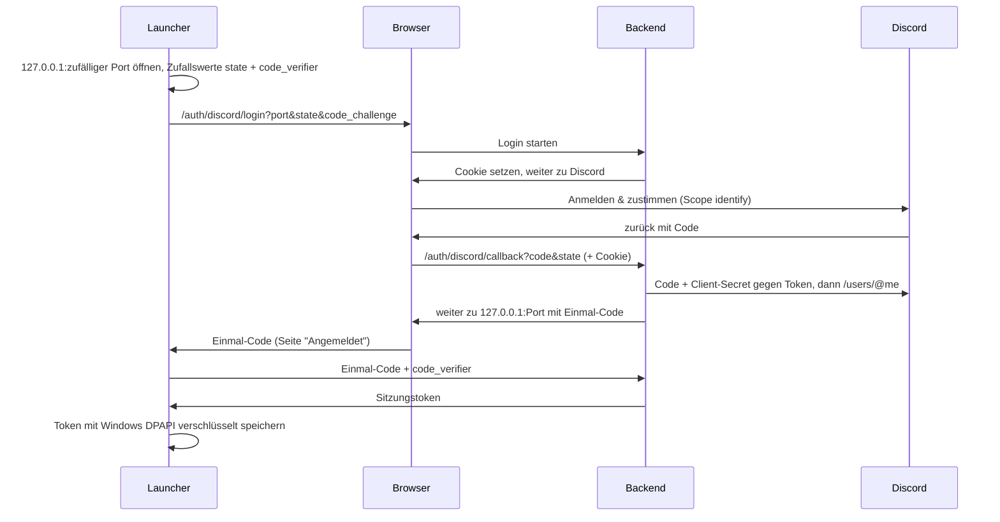

# Backend und Discord-Login

Wie die Anmeldung funktioniert, wie man sie lokal ausprobiert und was man einmalig einrichten muss (Discord-App, Coolify, GitHub).

## 1. Überblick

Das Backend (`backend/AoS2.Backend`, ASP.NET Core mit PostgreSQL über EF Core) kennt die Spieler-Konten. Es meldet Spieler über Discord an, gibt Sitzungstoken aus und stellt Join-Tickets für Spielserver aus.

| Pfad | Wer ruft auf | Zweck |
|---|---|---|
| `GET /auth/discord/login` | Browser (vom Launcher geöffnet) | Anmeldung starten, Weiterleitung zu Discord |
| `GET /auth/discord/callback` | Browser (von Discord zurück) | Konto anlegen/aktualisieren, Weiterleitung zum Launcher |
| `POST /auth/session` | Launcher | Einmal-Code gegen Sitzungstoken tauschen |
| `POST /auth/logout` | Launcher | Sitzung beenden |
| `GET /me` | Launcher, Spiel | Eigenes Konto (Name, Profilbild) |
| `POST /join-tickets` | Spiel (ab M4) | Kurzlebiges Ticket für einen bestimmten Spielserver |
| `GET /.well-known/jwks.json` | Spielserver (ab M4) | Öffentlicher Schlüssel zum Prüfen der Tickets |
| `GET /health` | Docker, Coolify | Läuft das Backend, erreicht es die Datenbank? |

Die Datenformate (DTOs) liegen in `libs/AoS2.Contracts`. Backend, Launcher und Spiel nutzen dieselben Klassen; im Spiel ist die Bibliothek wie `AoS2.Shared` als Unity-Package eingebunden.

## 2. So läuft die Anmeldung



Die Schutzmaßnahmen, Schritt für Schritt erklärt:

- **Client-Secret nur im Backend.** Launcher und Spiel liegen beim Spieler; alles darin kann man auslesen. Deshalb tauscht nur das Backend den Discord-Code gegen ein Token.
- **Nur `identify`.** Das Backend erfährt von Discord nur ID, Benutzername, Anzeigename und Profilbild, keine E-Mail-Adresse und keine Server.
- **Cookie im Browser.** Die Anmeldung gehört zu dem Browser, in dem sie gestartet wurde. Ein untergeschobener Discord-Rückkehr-Link aus einem fremden Browser wird abgelehnt.
- **PKCE** (`code_challenge`/`code_verifier`): Den Verifier kennt nur der Launcher. Fängt ein anderes Programm den Einmal-Code ab, kann es ihn ohne Verifier nicht eintauschen.
- **`state`**: Der Launcher nimmt nur die Weiterleitung seiner eigenen Anmeldung an.
- **Kurze Fristen:** 10 Minuten für die Anmeldung, 2 Minuten für den Einmal-Code. Jeder Code gilt genau einmal.
- **Nur Prüfsummen in der Datenbank.** Sitzungstoken und Einmal-Codes stehen nur als SHA-256 in PostgreSQL. Wer die Datenbank liest, kann sich damit nicht anmelden.
- **Sitzungen** laufen nach 30 Tagen ohne Benutzung ab. Wer regelmäßig spielt, bleibt angemeldet. „Abmelden“ im Launcher löscht die Sitzung auch im Backend.
- **DPAPI:** Der Launcher speichert die Anmeldung in `%LocalAppData%\AceOfSpades2\session.dat`, verschlüsselt mit dem Windows-Konto. Kopiert jemand die Datei auf einen anderen PC, nützt sie ihm nichts.
- **Übergabe an das Spiel** als Umgebungsvariablen `AOS2_SESSION_TOKEN` und `AOS2_BACKEND_URL`, nicht auf der Kommandozeile. Die Kommandozeile zeigen Task-Manager, Prozesslisten und Absturzberichte an. Die Umgebung gilt nur für den Spielprozess, und das Spiel löscht die Variable nach dem Lesen.
- **Spielserver bekommen nie das Sitzungstoken**, sondern ab M4 ein Join-Ticket (Abschnitt 6).

Ist das Backend beim Start nicht erreichbar, gilt die gespeicherte Anmeldung weiter („Anmeldeserver nicht erreichbar“ in den Einstellungen). Man kann also spielen, solange man sich einmal angemeldet hat.

## 3. Lokal entwickeln

Alles läuft auf dem eigenen PC, ohne Discord-App und ohne Passwörter.

### 3.1 Datenbank

```powershell
./tools/dev/dev-db.ps1
```

Legt beim ersten Mal mit der installierten PostgreSQL einen eigenen Datenbank-Cluster in `artifacts/dev-db` an und startet ihn auf `127.0.0.1:5433`. Benutzer `aos2`, kein Passwort; erreichbar nur vom eigenen PC. Die installierte PostgreSQL auf Port 5432 bleibt unberührt. Anhalten mit `-Stop`, komplett löschen mit `-Reset`.

### 3.2 Backend

```powershell
dotnet run --project backend/AoS2.Backend
```

Das Profil `dev-login` (Standard, siehe `backend/AoS2.Backend/Properties/launchSettings.json`) startet das Backend auf `http://localhost:5080` mit der Datenbank aus 3.1. Die Tabellen legt es beim Start selbst an. Statt Discord zeigt es eine **Entwicklungs-Login-Seite**, auf der man einen beliebigen Namen eingibt. Diese Seite gibt es nur in der Development-Umgebung; auf dem Server verweigert das Backend den Start, falls sie eingeschaltet ist.

### 3.3 Launcher und Spiel

```powershell
./tools/release/build-game.ps1 -Version 0.2.0      # einmal: Spiel bauen, lokaler Update-Speicher
$env:AOS2_BACKEND_URL = 'http://localhost:5080'
$env:AOS2_UPDATE_URL = "$PWD\artifacts\release"
$env:AOS2_DATA_DIR = "$PWD\artifacts\test-data"    # optional: nicht die echte Anmeldung überschreiben
dotnet run --project launcher/AoS2.Launcher
```

„Mit Discord anmelden“ öffnet den Browser mit der Entwicklungs-Login-Seite. Nach „Anmelden“ zeigt der Launcher oben rechts den Namen, und nach „Spielen“ zeigt das Spiel „Angemeldet als …“.

### 3.4 Im Unity-Editor

Im Play-Modus gibt es keinen Launcher. Das Spiel liest dann die gespeicherte Anmeldung des Launchers (`%LocalAppData%\AceOfSpades2\session.dat`, oder der Ordner aus `AOS2_DATA_DIR`). Einmal im Launcher anmelden reicht also, solange das Backend aus der Anmeldung läuft. Ohne gespeicherte Anmeldung zeigt das Spiel „Nicht angemeldet“.

### 3.5 Mit der echten Discord-App lokal testen

Erst Abschnitt 4.1 erledigen (inklusive Redirect `http://localhost:5080/auth/discord/callback`). Dann die Zugangsdaten in **dotnet user-secrets** eintragen. Das ist ein Ordner in deinem Windows-Profil, nicht im Repository:

```powershell
dotnet user-secrets set "Discord:ClientId" "<Client ID>" --project backend/AoS2.Backend
dotnet user-secrets set "Discord:ClientSecret" "<Client Secret>" --project backend/AoS2.Backend
dotnet run --project backend/AoS2.Backend --launch-profile discord
```

### 3.6 Datenbank-Schema ändern

Die Tabellen sind C#-Klassen in `backend/AoS2.Backend/Data/BackendDb.cs`. Nach einer Änderung eine Migration erzeugen; das Backend spielt sie beim nächsten Start selbst ein (auch auf dem Server):

```powershell
dotnet tool restore
dotnet ef migrations add NameDerAenderung --project backend/AoS2.Backend --output-dir Data/Migrations
```

Die Tests nutzen statt PostgreSQL eine SQLite-Datenbank im Arbeitsspeicher und ein nachgebildetes Discord (`backend/AoS2.Backend.Tests`).

## 4. Einmalige Einrichtung

Zugangsdaten trägst du nur an den hier genannten Stellen ein, nie in Dateien im Repository.

### 4.1 Discord-Anwendung

1. [discord.com/developers/applications](https://discord.com/developers/applications) öffnen und mit deinem Discord-Konto anmelden.
2. **New Application**, Name `Ace of Spades 2`, den Bedingungen zustimmen, **Create**.
3. Unter **General Information** kannst du ein Icon setzen. Spieler sehen es auf der Zustimmungsseite.
4. Links **OAuth2** öffnen:
   - **Client ID** kopieren. Sie ist nicht geheim.
   - **Client Secret → Reset Secret**. Das Secret wird nur einmal angezeigt; sofort in Coolify eintragen (4.3) und nirgends sonst speichern. Ist es verloren, einfach neu erzeugen und in Coolify ersetzen.
   - **Redirects → Add Redirect**, genau so (ohne `/` am Ende):
     - `https://<Backend-Adresse>/auth/discord/callback`, z. B. `https://api.deine-domain.de/auth/discord/callback`
     - optional für 3.5: `http://localhost:5080/auth/discord/callback`
   - **Save Changes**.

Den Bot-Bereich und den „OAuth2 URL Generator“ brauchst du nicht.

### 4.2 Signaturschlüssel für Join-Tickets

Einmal erzeugen (gibt eine lange Zeile aus, das ist der private Schlüssel):

```powershell
dotnet run --project backend/AoS2.Backend -- generate-signing-key
```

Die Zeile kommt in Coolify in `JOIN_TICKET_SIGNING_KEY` (4.3) und sonst nirgends hin. Wechselt man den Schlüssel, werden nur gerade laufende Join-Tickets ungültig; Konten und Sitzungen bleiben.

### 4.3 Coolify

**Datenbank:**

1. Im Projekt **+ New → Database → PostgreSQL**. Version 18 (oder die neueste angebotene), Name z. B. `aos2-db`. Starten.
2. In der Datenbank die **interne URL** kopieren (`postgres://…@…:5432/postgres`). Sie ist nur innerhalb von Coolify erreichbar. Das Backend versteht die URL-Form direkt.
3. Öffentlich erreichbar machen (`Make it publicly available`) ist nicht nötig.

**Backend:**

1. **+ New → Docker Compose** aus diesem Repository (öffentliches GitHub-Repo, Branch `main`), Compose-Datei `deploy/docker-compose.yml`.
2. **Environment Variables:**

   | Variable | Wert |
   |---|---|
   | `BACKEND_PUBLIC_URL` | z. B. `https://api.deine-domain.de` (ohne `/` am Ende) |
   | `POSTGRES_CONNECTION` | interne URL der Datenbank aus Schritt 2 |
   | `DISCORD_CLIENT_ID` | aus 4.1 |
   | `DISCORD_CLIENT_SECRET` | aus 4.1 |
   | `JOIN_TICKET_SIGNING_KEY` | aus 4.2 |

3. Beim Dienst `backend` die **Domain** eintragen, z. B. `https://api.deine-domain.de:8080` (Coolify-Schreibweise: Domain plus Container-Port). Der DNS-Eintrag der Domain muss auf den Coolify-Server zeigen; das HTTPS-Zertifikat holt Coolify selbst.
4. **Deploy**. Danach muss `https://api.deine-domain.de/health` im Browser `ok` zeigen.

**Image:** Die CI legt das Image bei jedem Release unter `ghcr.io/janhoeck/aos2-backend` ab (Abschnitt 4.4). Nach dem ersten Release auf GitHub unter **Profil → Packages → aos2-backend → Package settings → Change visibility → Public** stellen, sonst kann Coolify es nicht ohne Zugangsdaten laden.

**Redeploy per Webhook** (damit die CI nach einem Release neu startet):

1. In Coolify **Keys & Tokens → API tokens**: Token mit Berechtigung `deploy` anlegen. Wird nur einmal angezeigt.
2. Beim Backend unter **Webhooks** die **Deploy Webhook**-URL kopieren.
3. Beides in GitHub eintragen (4.4).

### 4.4 GitHub: Variablen und Secrets

Zusätzlich zu [release.md](release.md#22-github-secrets-und-variablen), im Repository unter **Settings → Secrets and variables → Actions**:

| Art | Name | Wert |
|---|---|---|
| Variable | `BACKEND_URL` | z. B. `https://api.deine-domain.de`; wird fest in den Launcher eingebaut |
| Variable | `COOLIFY_ENABLED` | `true`, sobald die beiden Secrets eingetragen sind |
| Secret | `COOLIFY_WEBHOOK` | Deploy-Webhook-URL aus 4.3 |
| Secret | `COOLIFY_TOKEN` | API-Token aus 4.3 |

Für das Image braucht es kein Secret; die CI nutzt das automatische `GITHUB_TOKEN`.

Ablauf bei einem Release-Tag (`.github/workflows/release.yml`): Tests → Backend-Image bauen und nach ghcr.io hochladen (`:0.2.0` und `:latest`) → Coolify-Webhook → Coolify lädt das neue Image und startet das Backend neu; fehlende Migrationen spielt es beim Start ein. Der Launcher wird mit `BACKEND_URL` gebaut. Bei jedem Pull Request baut die CI das Image testweise, ohne es hochzuladen.

## 5. Konfiguration

Das Backend liest `appsettings.json`, dann Umgebungsvariablen (`:` wird zu `__`), in der Entwicklung zusätzlich user-secrets.

| Einstellung | Umgebungsvariable | Bedeutung |
|---|---|---|
| `Backend:PublicUrl` | `Backend__PublicUrl` | Öffentliche Adresse; daraus werden Discord-Redirect und Ticket-Aussteller gebildet |
| `ConnectionStrings:Postgres` | `ConnectionStrings__Postgres` | `Host=…;Database=…;Username=…;Password=…` oder `postgres://…` |
| `Discord:ClientId` / `Discord:ClientSecret` | `Discord__ClientId` / `Discord__ClientSecret` | aus 4.1 |
| `Discord:UseDevLogin` | `Discord__UseDevLogin` | nur Development: Entwicklungs-Login statt Discord |
| `JoinTickets:SigningKey` | `JoinTickets__SigningKey` | privater Schlüssel aus 4.2; in Development ohne Angabe ein zufälliger |
| `Backend:MigrateOnStartup` | `Backend__MigrateOnStartup` | Standard `true` |

Fehlt eine Pflicht-Einstellung, startet das Backend nicht und nennt die fehlende Einstellung im Log.

Launcher: `AOS2_BACKEND_URL` (zum Testen) bzw. beim Bauen `-p:AoS2BackendUrl=…` (`pack-launcher.ps1 -BackendUrl …`).

## 6. Join-Tickets (für M4)

Ein Join-Ticket ist ein JWT, signiert mit ECDSA P-256 (ES256), 60 Sekunden gültig:

| Feld | Inhalt |
|---|---|
| `iss` | Backend-Adresse (`Backend:PublicUrl`) |
| `aud` | Zielserver, wie vom Client angegeben, klein geschrieben (z. B. `play.example.org:32887`) |
| `sub` | Konto-ID |
| `name` | Anzeigename |
| `jti` | Eindeutige Ticket-ID (gegen doppelte Verwendung) |
| `iat`, `nbf`, `exp` | Ausgestellt, gültig ab, gültig bis |

Ausstellen und Prüfen liegt in `libs/AoS2.JoinTickets`. Ein Spielserver braucht nur den öffentlichen Schlüssel von `/.well-known/jwks.json`:

```csharp
var keys = await http.GetStringAsync("https://api.example.org/.well-known/jwks.json");
var validator = new JoinTicketValidator(keys, "https://api.example.org", "play.example.org:32887", TimeProvider.System);
var ticket = await validator.ValidateAsync(ticketVomClient);   // null = ungültig
```

Der Server prüft Signatur, Aussteller, Zielserver und Ablauf (30 Sekunden Toleranz für ungenaue Uhren). Damit jedes Ticket nur einmal gilt, merkt er sich die `TicketId` bis zum Ablauf. Das kommt mit M4.

## 7. Wenn etwas schiefgeht

| Problem | Ursache / Lösung |
|---|---|
| Launcher: „Kein Anmeldeserver eingestellt“ | Launcher ohne `-BackendUrl` gebaut. Zum Testen `AOS2_BACKEND_URL` setzen. |
| Launcher: „Der Anmeldeserver antwortet nicht“ | Backend aus oder Adresse falsch. `<Backend>/health` im Browser öffnen. |
| Discord: „Invalid OAuth2 redirect_uri“ | Redirect in 4.1 stimmt nicht genau mit `Backend:PublicUrl` + `/auth/discord/callback` überein (http/https, `/` am Ende, Port). |
| Browser: „Anmeldung abgelaufen“ | Mehr als 10 Minuten gewartet, oder der Rückkehr-Link wurde in einem anderen Browser geöffnet. Im Launcher neu starten. |
| Launcher: „Discord hat nicht richtig geantwortet“ | Client-Secret falsch oder Discord gestört. Backend-Log ansehen („Discord-Login fehlgeschlagen“). |
| Backend startet nicht: „… fehlt“ | Pflicht-Einstellung fehlt (Abschnitt 5). |
| Spiel: „Anmeldung abgelaufen“ | Sitzung abgelaufen oder abgemeldet. Im Launcher neu anmelden. |
| Spiel im Editor: „Nicht angemeldet“ | Noch nie im Launcher angemeldet, oder `AOS2_DATA_DIR` zeigt woanders hin. |
| `dev-db.ps1`: initdb nicht gefunden | PostgreSQL installieren oder `C:\Program Files\PostgreSQL\<Version>\bin` in den PATH. |
| Coolify lädt das neue Image nicht | Package auf ghcr.io nicht öffentlich (4.3) oder Redeploy ohne Neuladen des Images: In Coolify einmal von Hand „Redeploy“ auslösen und das Log prüfen. |
