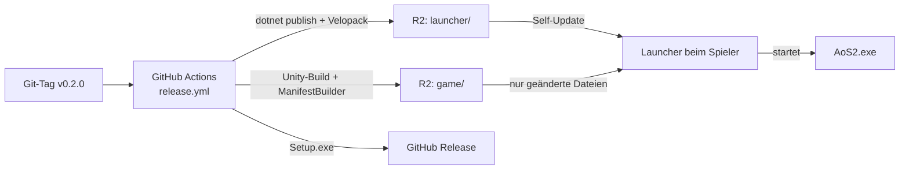

# Releases und Updates

Wie eine neue Version vom Repository zu den Spielern kommt, und was man dafür einmalig einrichten muss.

## 1. Überblick



Alles, was Spieler herunterladen, liegt in **einem** Cloudflare-R2-Bucket:

```
game/manifest.json            aktuelle Spielversion: alle Dateien mit Größe und SHA-256
game/manifests/0.2.0.json     ältere Manifeste (Archiv)
game/objects/ab/ab12…         Dateiinhalte, benannt nach ihrer Prüfsumme
launcher/releases.win.json    Velopack: Liste der Launcher-Versionen
launcher/*.nupkg              Velopack: Voll- und Delta-Pakete
launcher/AoS2.Launcher-win-Setup.exe
```

**Warum Dateien nach ihrer Prüfsumme benannt sind:** Ein Objekt ändert sich nie. Ein neues Release lädt nur Inhalte hoch, die es noch nicht gibt, und die alte Version bleibt vollständig, bis zum Schluss das neue `manifest.json` hochgeladen wird. Kein Spieler erwischt also eine halb hochgeladene Version.

**Was der Launcher beim Start macht** (Code: `launcher/AoS2.Launcher`, Logik: `libs/AoS2.Updates`):

1. Velopack fragt `launcher/releases.win.json` ab. Gibt es eine neuere Version, lädt er sie, tauscht sich aus und startet neu.
2. `game/manifest.json` laden und prüfen (gültige Pfade, nichts außerhalb des Spielordners). Beim ersten Start fragt der Launcher vorher, wohin das Spiel soll, und zeigt Platzbedarf und freien Platz. Wählt man einen Ordner, der schon anderes enthält (z. B. `D:\Spiele`), legt er darin `Ace of Spades 2` an.
3. Lokale Dateien vergleichen. Stimmen Größe und Änderungszeit mit dem gespeicherten Stand (`.aos2/install.json`) überein, wird nicht neu gehasht. „Dateien prüfen“ hasht alles.
4. Nur fehlende oder geänderte Dateien laden, jede beim Laden gegen ihre SHA-256 prüfen, dann an ihren Platz verschieben. Dateien der alten Version, die es nicht mehr gibt, werden gelöscht.
5. „Spielen“ startet `AoS2.exe`. Ohne Verbindung zum Server kann man die zuletzt vollständig installierte Version weiterspielen.

| Was | Wo beim Spieler |
|---|---|
| Launcher (Velopack) | `%LocalAppData%\AoS2.Launcher\` |
| Einstellungen | `%LocalAppData%\AceOfSpades2\launcher.json` (Spielordner, „Launcher schließen, wenn das Spiel startet“) |
| Spiel | beim ersten Start gewählt, Vorschlag `%LocalAppData%\AceOfSpades2\Game\`. Später über Einstellungen → „Verschieben“ änderbar. |

Beim Deinstallieren des Launchers wird das Spiel mit entfernt, aber nur die Dateien, die der Launcher selbst installiert hat (laut `.aos2/install.json`). Fremde Dateien im Spielordner bleiben liegen.

Das Design des Launchers („Voxel-Schlachtfeld“) liegt als Entwurf in Claude Design; Farben und Bausteine stehen in `launcher/AoS2.Launcher/App.axaml`.

## 2. Einmalige Einrichtung

### 2.1 Cloudflare R2

1. Auf [dash.cloudflare.com](https://dash.cloudflare.com) ein Konto anlegen bzw. anmelden.
2. Links **R2 Object Storage** öffnen und R2 aktivieren. Cloudflare verlangt dafür eine Zahlungsmethode, auch für den kostenlosen Umfang (10 GB Speicher, Downloads kosten nichts).
3. **Create bucket**, Name z. B. `aos2-updates`, Standort automatisch.
4. Öffentlichen Zugriff einrichten – im Bucket unter **Settings → Public access**:
   - **Empfohlen: Custom Domain**, z. B. `updates.deine-domain.de`. Die Domain muss bei Cloudflare verwaltet werden.
   - **Nur zum Testen: r2.dev-Subdomain** (`https://pub-….r2.dev`). Cloudflare begrenzt diese Adresse und rät von echter Nutzung ab.

   Die so entstandene Adresse ist die **Update-URL** (ohne `/` am Ende). Sie wird in den Launcher eingebaut. Sie später zu ändern heißt: Spieler müssen einen neuen Launcher installieren. Deshalb lieber gleich die eigene Domain nehmen.
5. API-Token für den Upload: **R2 Object Storage → Manage API tokens → Create API token**
   - Berechtigung: **Object Read & Write**
   - Nur für den Bucket `aos2-updates`
   - Nach dem Erstellen werden **Access Key ID** und **Secret Access Key** genau einmal angezeigt. Sofort in GitHub eintragen (nächster Schritt) und nirgends sonst speichern.
6. Die **Account ID** steht in der R2-Übersicht rechts.

### 2.2 GitHub: Secrets und Variablen

Im Repository: **Settings → Secrets and variables → Actions**.

| Art | Name | Wert |
|---|---|---|
| Secret | `R2_ACCOUNT_ID` | Account ID aus 2.1 |
| Secret | `R2_ACCESS_KEY_ID` | Access Key ID aus 2.1 |
| Secret | `R2_SECRET_ACCESS_KEY` | Secret Access Key aus 2.1 |
| Variable | `R2_BUCKET` | `aos2-updates` |
| Variable | `UPDATE_BASE_URL` | z. B. `https://updates.deine-domain.de` |
| Variable | `UNITY_CI_ENABLED` | erst `true` setzen, wenn 2.3 erledigt ist |
| Variable | `BACKEND_URL` | Adresse des Backends, z. B. `https://api.deine-domain.de` (siehe [backend.md](backend.md#44-github-variablen-und-secrets)) |

Secrets sind nach dem Speichern nicht mehr lesbar und erscheinen in Logs als `***`.

### 2.3 Unity-Build in der CI (GameCI)

Ohne diesen Schritt baut die CI nur den Launcher; das Spiel lädt man dann lokal hoch (Abschnitt 4).

1. Anleitung „Activation – Personal License“ auf [game.ci/docs/github/activation](https://game.ci/docs/github/activation) befolgen. Kurz: Unity Hub mit dem eigenen Konto anmelden, dann liegt die Lizenzdatei unter `C:\ProgramData\Unity\Unity_lic.ulf`.
2. Secrets anlegen:
   - `UNITY_LICENSE`: kompletter Inhalt der `.ulf`-Datei
   - `UNITY_EMAIL`, `UNITY_PASSWORD`: Zugangsdaten des Unity-Kontos
3. Variable `UNITY_CI_ENABLED` = `true`.
4. Prüfen, ob es für die Unity-Version aus `client/ProjectSettings/ProjectVersion.txt` ein GameCI-Image gibt ([game.ci/docs/docker/versions](https://game.ci/docs/docker/versions), Plattform „windows-mono“ unter Ubuntu). Falls nicht: Unity-Version anheben oder lokal bauen.

### 2.4 Lokaler Upload (optional)

Nur nötig, wenn man ohne CI hochladen will.

```powershell
winget install Amazon.AWSCLI
```

Die Zugangsdaten nur in der aktuellen PowerShell-Sitzung setzen (nicht in Dateien im Repo):

```powershell
$env:R2_ACCOUNT_ID = '…'
$env:R2_ACCESS_KEY_ID = '…'
$env:R2_SECRET_ACCESS_KEY = '…'
$env:R2_BUCKET = 'aos2-updates'
```

## 3. Release erstellen

Eine gemeinsame Versionsnummer für Spiel und Launcher, gesetzt per Git-Tag:

```bash
git tag v0.1.0
git push origin v0.1.0
```

Der Workflow `.github/workflows/release.yml` läuft dann so ab:

| Job | Läuft auf | Macht |
|---|---|---|
| Version bestimmen | Ubuntu | `v0.1.0` → `0.1.0`, bricht bei ungültigem Tag ab |
| .NET bauen und testen | Ubuntu | wie bei Pull Requests |
| Spiel bauen und hochladen | Ubuntu (Docker) | nur wenn `UNITY_CI_ENABLED = true`: GameCI-Build → ManifestBuilder → `upload-game.ps1` |
| Launcher paketieren und hochladen | Windows | `pack-launcher.ps1 -Upload` → R2 `launcher/`, Setup.exe ins GitHub-Release |

Neue Spieler laden `AoS2-Setup.exe` aus dem GitHub-Release (oder direkt `<Update-URL>/launcher/AoS2.Launcher-win-Setup.exe`).

> Der Launcher ist nicht signiert. Windows SmartScreen warnt deshalb beim ersten Start („Weitere Informationen → Trotzdem ausführen“). Code-Signing ist für M9 geplant.

## 4. Spiel lokal bauen und hochladen

Solange GameCI nicht eingerichtet ist (oder für schnelle Tests):

```powershell
./tools/release/build-game.ps1 -Version 0.1.0 -Upload
```

Das Skript baut den Unity-Client im Batchmode nach `artifacts/unity-build/`, erzeugt mit dem ManifestBuilder `artifacts/release/game/` und lädt das hoch (braucht 2.4). Achtung: Das Manifest im Bucket ist danach diese Version, auch wenn die CI schon eine neuere hochgeladen hat.

## 5. Ohne R2 lokal testen

`artifacts/release` ist nach einem Build ein vollständiger Update-Speicher. Der Launcher kann statt einer URL auch einen Ordner nutzen.

```powershell
# Spiel bauen, ohne Upload
./tools/release/build-game.ps1 -Version 0.1.0

# Launcher aus dem Quellcode starten, mit dem Ordner als Update-Speicher
# und dem lokalen Backend für die Anmeldung (Backend starten: siehe backend.md, Abschnitt 3)
$env:AOS2_UPDATE_URL = "$PWD\artifacts\release"
$env:AOS2_BACKEND_URL = "http://localhost:5080"
$env:AOS2_DATA_DIR = "$PWD\artifacts\test-data"   # optional: Einstellungen hierhin statt nach %LocalAppData%\AceOfSpades2
dotnet run --project launcher/AoS2.Launcher
```

Update testen: in Unity etwas ändern, `build-game.ps1 -Version 0.1.1` ausführen, Launcher neu starten. Er lädt nur die geänderten Dateien.

Velopack-Installer und Self-Update lokal testen:

```powershell
./tools/release/pack-launcher.ps1 -Version 0.1.0 -UpdateUrl "$PWD\artifacts\release"
artifacts\release\launcher\AoS2.Launcher-win-Setup.exe   # installiert nach %LocalAppData%\AoS2.Launcher
./tools/release/pack-launcher.ps1 -Version 0.1.1 -UpdateUrl "$PWD\artifacts\release"
# Launcher neu starten → er aktualisiert sich auf 0.1.1
```

Deinstallieren: Windows-Einstellungen → Apps → „Ace of Spades 2“.

## 6. Werkzeuge

| Werkzeug | Zweck |
|---|---|
| `tools/AoS2.ManifestBuilder` | Unity-Build → `game/manifest.json` + `game/objects/`. Hilfe: `dotnet run --project tools/AoS2.ManifestBuilder -- --help` |
| `tools/release/build-game.ps1` | Unity-Build + ManifestBuilder (+ Upload) |
| `tools/release/upload-game.ps1` | `game/` nach R2: erst Objekte, zuletzt das Manifest |
| `tools/release/pack-launcher.ps1` | `dotnet publish` + Velopack (+ Upload) |
| `vpk` | Velopack-Kommandozeile, als lokales .NET-Tool in `dotnet-tools.json` festgelegt |

Unity-Build von Hand im Editor: Menü **AoS2 → Windows-Build erstellen** (landet in `client/Builds/`).

## 7. Wenn etwas schiefgeht

| Problem | Ursache / Lösung |
|---|---|
| Launcher: „Kein Anmeldeserver eingestellt“ | Launcher wurde ohne `-BackendUrl` gebaut. Beim Test `AOS2_BACKEND_URL` setzen. Weitere Login-Probleme: [backend.md](backend.md#7-wenn-etwas-schiefgeht). |
| Launcher: „Kein Update-Server eingestellt“ | Launcher wurde ohne `-UpdateUrl` gebaut. Beim Test `AOS2_UPDATE_URL` setzen. |
| Launcher: „Keine Verbindung zum Update-Server“ | URL falsch, Bucket nicht öffentlich oder offline. `<Update-URL>/game/manifest.json` im Browser öffnen. |
| „Die Prüfsumme stimmt nicht“ | Objekt im Bucket beschädigt oder unvollständig hochgeladen. `upload-game.ps1` erneut ausführen. |
| „Dateifehler … Läuft das Spiel noch?“ | Das Spiel ist offen und Windows sperrt die Dateien. Spiel beenden, „Erneut versuchen“. |
| AWS CLI: Fehler zu Checksums | Das Skript setzt `AWS_REQUEST_CHECKSUM_CALCULATION=when_required`. Bei eigenen Aufrufen ebenfalls setzen. |
| Job „Spiel bauen“ wird übersprungen | Variable `UNITY_CI_ENABLED` fehlt oder ist nicht `true`. |
